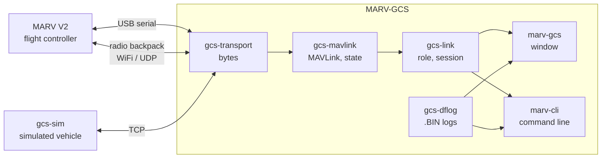

# MARV-GCS

Ground station for the MARV flight controller, in Rust, speaking MAVLink 2 with the project's own `marv` dialect.
`marv-gcs` is the desktop window (live sensors, parameters, calibrations, motors, radio, map and waypoint missions, flight
commands, on-board log download, log review). `marv-cli` is the same station without a window, for a companion computer
or a script. Both run on one shared session layer, so the same rules apply to each. Without a board, `gcs-sim` is a
simulated vehicle that behaves as the [link contract](docs/link-contract.md) says the firmware does.



## Quick start

```
cargo run -p gcs-sim                                      # simulated vehicle on 127.0.0.1:5760
cargo run -p marv-gcs -- --connect tcp:127.0.0.1:5760     # the window, connected to it
cargo run -p marv-cli -- --connect tcp:127.0.0.1:5760 status
```

With a board, plug in its USB port and use `--connect serial:/dev/ttyACM0` (on Linux the user must be in `dialout`), or
choose `Serial` in the window's top bar. Through the transmitter's WiFi backpack use `--connect udp:0.0.0.0:14550`.
Building needs Rust 1.99 or newer and, on Linux, the libudev development package. Details: [ui](docs/ui.md),
[marv-cli](docs/marv-cli.md).

## Index

| Page | In one line |
|---|---|
| [architecture](docs/architecture.md) | Eight crates, layer rules, the interfaces between them |
| [ui](docs/ui.md) | The window: connection bar, HUD, sidebar, tab index, start-up options, AppImage |
| [ui-tabs](docs/ui-tabs.md) | Sensors, Messages, Parameters, Link and Motors tabs |
| [ui-radio-devices](docs/ui-radio-devices.md) | Radio calibration and mapping; Devices, sensor presets, compass calibration |
| [ui-map](docs/ui-map.md) | Map tab, waypoint lists, mission upload, flight commands, tiles and privacy |
| [marv-cli](docs/marv-cli.md) | Every command, output format, exit status, Raspberry Pi build |
| [sessions-and-logs](docs/sessions-and-logs.md) | `.tlog` recording, session folders and CSV, on-board log download, log review and CSV export |
| [dflog](docs/dflog.md) | DataFlash reader, event timeline, condition search, CSV export |
| [flight-report](docs/flight-report.md) | `marv-cli log report`: sections, flight definition, identification, vibration, tracking |
| [link-contract](docs/link-contract.md) | The wire contract between vehicle and station, with its pages: [parameters](docs/link-parameters.md), [access](docs/link-access.md), [commands](docs/link-commands.md), [flight](docs/link-flight.md), [logs](docs/link-logs.md), [missions](docs/link-missions.md), [telemetry](docs/link-telemetry.md), [presets](docs/link-presets.md), [compass](docs/link-compass.md), [USB and device layer](docs/link-usb.md) |
| [extending](docs/extending.md) | Recipes: a tab, a service, a transport, a preset, a CLI command, a message |
| Crate folders | [gcs-transport](crates/gcs-transport/README.md), [gcs-mavlink](crates/gcs-mavlink/README.md), [gcs-link](crates/gcs-link/README.md), [gcs-dflog](crates/gcs-dflog/README.md), [gcs-magcal](crates/gcs-magcal/README.md), [gcs-sim](crates/gcs-sim/README.md), [marv-gcs](crates/marv-gcs/README.md), [marv-cli](crates/marv-cli/README.md) |

## Tests

```
cargo test --workspace          # needs /usr/bin/socat for the serial tests; some tests are ignored (they need a board or a recording)
cargo clippy --workspace --all-targets -- -D warnings
tools/board_check.sh <dir>      # with a board on its debug probe and USB port: flashes the mavlink-device demo and runs crates/marv-gcs/tests/board.rs
```

Under a small memory cap build with `-j 4`; the test binaries each carry the Map tab's HTTP stack.

## Status

| Area | State |
|---|---|
| Protocol services, framing, state machines | Host tests with a made-up clock; framing checked against the `mavlink` crate for every message type |
| Window and command line against `gcs-sim` | End-to-end tests over TCP, a pseudo serial port and UDP; views drawn and clicked headless with `egui_kittest` |
| Real board over USB and radio | Telemetry, device rows, parameters, calibrations, sensor presets, radio calibration and mapping, on-board log download, log review |
| Simulator only so far | Motor test, flying-mission flows, `ATTITUDE` (the firmware sends none yet) |
| Not covered | Windows and macOS, signed MAVLink frames, more than one vehicle, firmware upload, joystick input |

Limits: MAVLink 2 only; parameter types up to 32 bits; no automatic parameter re-fetch after the vehicle returns (press
Refresh); a TCP address that does not answer blocks the window for up to 2 s.

## MARV project

| Repository | Role |
|---|---|
| [MARV-FC](https://github.com/Lmx154/MARV-FC) | Flight-controller firmware for the MARV V2 board (RP2350B) |
| **MARV-GCS** | Ground station (`marv-gcs`) and command line (`marv-cli`) |
| [MARV-sim](https://github.com/Lmx154/MARV-sim) | Simulator that runs the firmware's flight code |
| Sensors | [icm45686](https://github.com/Lmx154/icm45686-rs) · [lsm6dsk320x](https://github.com/Lmx154/lsm6dsk320x-rs) · [bmp581](https://github.com/Lmx154/bmp581-rs) · [bmm350](https://github.com/Lmx154/bmm350-rs) · [sam-m10q](https://github.com/Lmx154/sam-m10q) · [adc-battery](https://github.com/Lmx154/adc-battery) |
| Board I/O | [pio-sdmmc](https://github.com/Lmx154/pio-sdmmc-rs) · [qmi-psram](https://github.com/Lmx154/qmi-psram-rs) · [ws2812c](https://github.com/Lmx154/ws2812c-rs) · [usb-cdc](https://github.com/Lmx154/usb-cdc) · [pio-uart](https://github.com/Lmx154/pio-uart) |
| Motors and links | [dshot](https://github.com/Lmx154/dshot-rs) · [esc-passthrough](https://github.com/Lmx154/esc-passthrough) · [rc-port](https://github.com/Lmx154/rc-port) · [crsf-codec](https://github.com/Lmx154/crsf-codec) · [mavlink-device](https://github.com/Lmx154/mavlink-device) · [marv-dialect](https://github.com/Lmx154/marv-dialect) |
| Other drivers | [lc76g](https://github.com/Lmx154/lc76g-rs) (Quectel LC76G GNSS) |

The station depends on [marv-dialect](https://github.com/Lmx154/marv-dialect) (one pinned revision) for the message
definitions. The vehicle end of the link is [usb-cdc](https://github.com/Lmx154/usb-cdc) and
[mavlink-device](https://github.com/Lmx154/mavlink-device) under the [MARV-FC](https://github.com/Lmx154/MARV-FC) firmware.

## License

MIT. The Log tab's file dialog uses the `rfd` crate (MIT) through the XDG desktop portal: no GTK is linked, and the portal
client loads the host's `libdbus-1` at run time.
