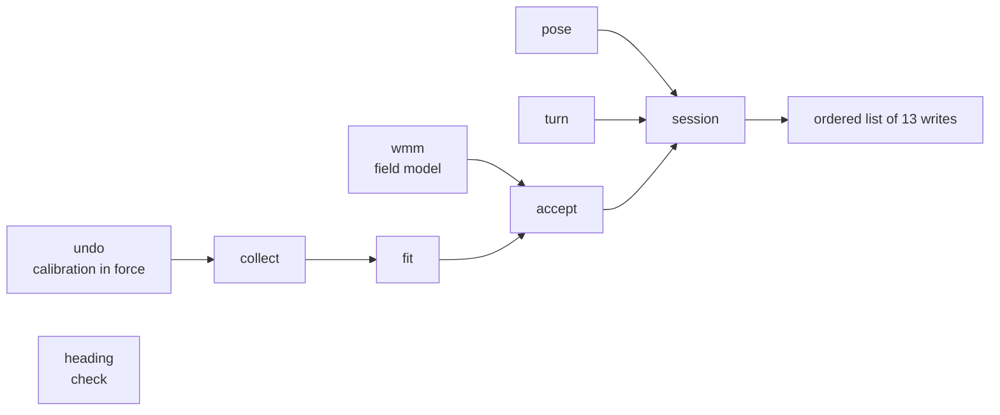

# gcs-magcal

Part of [MARV-GCS](../../README.md) · [link-compass](../../docs/link-compass.md)

The numerical core of the guided compass calibration. Pure: no I/O, no clock, no dependency beyond `std`. Units are
microtesla and degrees. The window's Compass panel ([ui-radio-devices](../../docs/ui-radio-devices.md)) is the view and the
wiring around it; the wire side (parameters, model, test vector, write order) is in [link-compass](../../docs/link-compass.md).

| Module | Contents |
|---|---|
| `wmm.rs` | World Magnetic Model 2025, degree 12, from NOAA's `WMM.COF` (public domain, `data/WMM.COF`), valid 2025.0 to 2030.0. `cargo run -p gcs-magcal --example wmm -- LAT LON HEIGHT_M YEAR` |
| `undo.rs` | The calibration in force, m = S (r - o); `Calibration::undo` refuses a matrix that is not positive definite; `gauss_to_ut` converts `HIGHRES_IMU`'s gauss |
| `fit.rs`, `linalg.rs` | PX4's Levenberg-Marquardt sphere fit then ellipsoid fit, ported from `lm_fit.cpp` (BSD-3-Clause; PX4's notice is kept in `src/fit.rs`). `cargo run -p gcs-magcal --example fit_csv -- FILE.csv [RADIUS_UT]` fits a CSV of raw x,y,z in uT |
| `accept.rs` | The acceptance checks in order, each with its message; on acceptance S is scaled so the mean corrected strength equals the model's, and the scaled terms are checked again against the same limits. Coverage (all six poses turned) is an input, `incomplete_poses`; acceptance without it is not a guarantee against poor coverage, since data with one direction missing can pass every numeric row |
| `pose.rs` | The six poses (level, upside down, nose down, nose up, left side down, right side down) recognised from one accelerometer sample with PX4's rule (each axis within 5 m/s² of the expected reading; FRD, specific force: level reads (0, 0, -g)) |
| `turn.rs` | The gyro integrated about the gravity axis while a pose is held; a ring of 12 sectors of 30 degrees per pose, complete when every sector was visited (either direction). An incomplete ring is cleared when another pose is recognised, not when the reading falls to "none"; a complete ring stays. A step longer than 0.5 s or not forward in time is not integrated |
| `collect.rs` | Raw samples (the calibration in force undone) with the unit down vector, thinned by PX4's spacing rule (5.4 R / sqrt(240) / 3, R the model's field strength) |
| `session.rs` | The state machine. `Session::start(calibration, gps, decimal_year, now)` refuses an invalid stored matrix or a missing, old or poor GPS fix; `sample`, `param_changed`, `armed`, `cancel`, `tick(now)` drive it; `status(now)` is the snapshot for a view; the outcome is `Accepted` with the ordered list of 13 writes or an ending with its message. It writes nothing. `verify_read_back` compares a read-back set with the plan (equal as f32) |
| `heading.rs` | The heading check over recorded data: tilt-compensated compass heading plus declination against GPS course, median difference and median absolute deviation, "within 10 deg" or "off by X deg: ..." |

Tests: `tests/pose.rs`, `turn.rs`, `collect.rs`, `session.rs` (a scripted user at 25 Hz), `heading.rs`; `wmm.rs` (NOAA's two
WMM2025 test tables, `tests/data/`), `undo.rs` (the contract's test vector and a round-trip property), `fit.rs` (synthetic
rings, a thin band, one test per acceptance row). `gcs-sim` uses `wmm` for its magnetometer.
