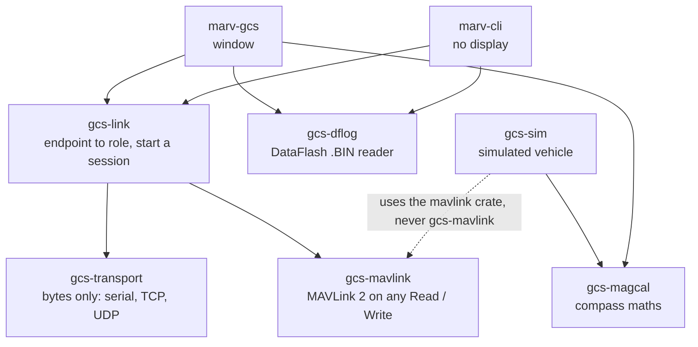

# Architecture

Part of [MARV-GCS](../README.md)

The station is eight crates. The dependency graph enforces the layers, so a broken rule does not build or shows up in
`cargo tree`. Protocol logic is sans-IO state machines; the window only reads one state structure and sends commands.



| Crate | Role | Folder |
|---|---|---|
| `gcs-transport` | Bytes: USB serial port, TCP, UDP. Never names MAVLink | [README](../crates/gcs-transport/README.md) |
| `gcs-mavlink` | Framing, one service per sub-protocol, vehicle state, `.tlog` record and replay, presets, parameter metadata | [README](../crates/gcs-mavlink/README.md) |
| `gcs-link` | The join: the role a link gives, session start, the `.tlog` to session-folder converter | [README](../crates/gcs-link/README.md) |
| `gcs-dflog` | DataFlash `.BIN` reader, event timeline, condition search, CSV export, flight report | [README](../crates/gcs-dflog/README.md) |
| `gcs-magcal` | Compass-calibration maths and procedure; no dependency | [README](../crates/gcs-magcal/README.md) |
| `gcs-sim` | Simulated vehicle, written from the link contract | [README](../crates/gcs-sim/README.md) |
| `marv-gcs` | The window and the `marv-link-test` tool | [README](../crates/marv-gcs/README.md) |
| `marv-cli` | The command line | [README](../crates/marv-cli/README.md) |

## Layer rules

1. **USB lives alone.** `gcs-transport` moves bytes and never depends on `mavlink` or `gcs-mavlink`.
2. **MAVLink is a layer on top.** `gcs-mavlink` takes any `std::io::Read` / `Write` pair and never depends on
   `gcs-transport`, `serialport` or a GUI crate.
3. **The join is small and has no GUI.** Only `gcs-link` and the applications depend on both. `gcs-link` holds
   `access_of` (the role a link gives), `start_session` and `session_folder`. Only `marv-gcs` depends on `eframe`,
   `walkers` (the Map tab's tiles, with an HTTP client) and `rfd` (the file dialog).
4. **The simulator is independent.** `gcs-sim` never depends on `gcs-mavlink`, so the two check each other. It may use
   `gcs-magcal` for the Earth's field.
5. **Protocol logic is sans-IO.** A service takes messages and the time and returns messages to send and events; no
   socket, thread, clock or GUI inside, so tests use plain calls and a made-up clock.
6. **Nothing is specific to one parameter or message** unless a view is about it. The parameter list is whatever the
   vehicle reports; every message is listed and plottable by generic field access.
7. **The log reader is independent.** `gcs-dflog` reads a file, depends on no workspace crate and no external crate.
8. **The compass maths is pure.** `gcs-magcal` is numbers in, numbers out; std only.

Checks (each prints the number shown):

| Command | Result |
|---|---|
| `cargo tree -p gcs-transport \| grep -c mavlink` | 0 |
| `cargo tree -p gcs-mavlink \| grep -cE 'serialport\|egui\|eframe'` | 0 |
| `cargo tree -p gcs-sim \| grep -c gcs-mavlink` | 0 |
| `cargo tree -p gcs-dflog -e normal \| wc -l`, same for `gcs-magcal` | 1 (its own line) |
| `cargo tree -p gcs-link -e normal \| grep -ciE 'eframe\|egui\|winit\|wgpu\|glow'`, same for `marv-cli` | 0 (`crates/marv-cli/tests/dependencies.rs` runs both) |

## Interfaces

### `gcs-transport`

```rust
pub enum Endpoint {
    Serial { path: String, baud: u32 },   // "serial:/dev/ttyACM0:115200"
    Tcp { addr: String },                 // "tcp:127.0.0.1:5760"
    Udp { bind: std::net::SocketAddr },   // "udp:0.0.0.0:14550", the local address to listen on
}                                         // FromStr + Display, round-trip exact
pub struct Link { pub reader: Box<dyn Read + Send>, pub writer: Box<dyn Write + Send> }
pub fn open(endpoint: &Endpoint) -> Result<Link, OpenError>;
pub fn list_serial_ports() -> Vec<PortInfo>;       // path plus USB vid, pid, product, serial
pub const READ_TIMEOUT: Duration;                  // 100 ms
```

What the layer above relies on, for every transport:

| Rule | Detail |
|---|---|
| `read` returns as soon as one byte is there | It does not wait to fill the buffer |
| No data for `READ_TIMEOUT` | `Err(TimedOut)`, never `WouldBlock`; no bytes are lost |
| `Ok(0)` or any other error | The link is down for good |
| Two halves | May be used from two threads; dropping both closes the link |

UDP (`udp.rs`): the peer is the source of the latest datagram; before one arrives a write succeeds and discards the
bytes; each write is one datagram; a datagram is returned over several reads when the buffer is small; empty datagrams
are skipped; `ConnectionRefused`, `ConnectionReset`, `NetworkUnreachable`, `HostUnreachable` and `NetworkDown` are not
link-down, on read or write (the write is discarded and the link stays up).

### `gcs-link`

```rust
pub fn access_of(endpoint: &Endpoint) -> Access;   // the one mapping: Serial, Tcp = Configure; Udp = Operate
pub fn start_session(endpoint: &Endpoint, access: Access, wake: Box<dyn Fn() + Send + Sync>)
    -> Result<gcs_mavlink::Session, OpenError>;
// gcs_link::session_folder: a recording into <out>/<UTC start>_<name>/, never overwriting (see sessions-and-logs.md)
pub fn export_session(tlog: &Path, out_dir: &Path, options: &SessionOptions) -> io::Result<Exported>;
pub fn list_sessions(dir: &Path) -> io::Result<Vec<SessionInfo>>;
```

### `gcs-mavlink`

```rust
pub use marv_dialect::marv as dialect;             // the one place that names the dialect
pub struct Frame { system_id, component_id, sequence, message_id, raw: Vec<u8>, body: Body }
pub enum Body { Known(Message), Undecodable(String), Unknown }   // Unknown: id not in the dialect, no checksum check
pub struct Deframer;  // push(bytes, &mut Vec<Frame>), stats() -> RxStats { frames, crc_errors, unknown, undecodable, discarded_bytes }
pub struct Encoder;   // new(system_id, component_id), encode(&Message) -> Vec<u8>

pub trait Service: Send {                          // one sub-protocol as a state machine
    fn on_frame(&mut self, frame: &Frame, cx: &mut Ctx) {}
    fn on_sent(&mut self, raw: &[u8], cx: &mut Ctx) {}
    fn on_tick(&mut self, cx: &mut Ctx) {}         // at least every 50 ms
    fn on_command(&mut self, command: &Command, cx: &mut Ctx) {}
}
pub struct Ctx<'a> { now: Duration, wall_time_us: u64, state: &'a mut VehicleState, out: &'a mut Vec<Message>, changed: bool }
pub fn default_services(config: &SessionConfig) -> Vec<Box<dyn Service>>;   // the registry

pub struct Session;  // start(reader, writer, config, wake), state() -> MutexGuard<VehicleState>, send(Command)
pub struct SessionConfig { system_id: 255, component_id: 190, heartbeat_timeout: 5 s, access: Operate }
pub enum Access { Operate, Configure }             // fixed per session
```

`VehicleState` holds one section per service: `link`, `messages`, `params`, `texts`, `log`, `logs`, `command`,
`missions`, `flight`. `LinkStatus` is `Connecting`, `Connected`, `Lost` (no heartbeat for 5 s) or `Closed(reason)`.
`Session::send` is the one choke point for the window and the command line: a command whose class
(`Command::access`, an exhaustive `match`) needs more than the session's `Access` is refused, nothing is written and
`link.refused` records it. See [roles and commands](link-access.md).

### `marv-gcs` views and `marv-cli`

```rust
pub trait View {
    fn name(&self) -> &'static str;                          // tab title
    fn ui(&mut self, ui: &mut egui::Ui, cx: &mut ViewCtx);   // cx: state (read only), commands to send, now, access
    fn scrolls(&self) -> bool; fn session_changed(&mut self); fn update(&mut self, state, now);
}
pub fn all() -> Vec<Box<dyn View>>;                          // the registry in views/mod.rs
// marv-cli
pub fn run(args: &[String], out: &mut dyn Write, err: &mut dyn Write) -> i32;   // parse, open, execute; exit status
```

## Related

- [extending](extending.md): recipes for a tab, a service, a transport, a preset, a CLI command.
- [ui](ui.md), [marv-cli](marv-cli.md): the two applications.
- [link-contract](link-contract.md): what the vehicle and the station must do on the wire.
