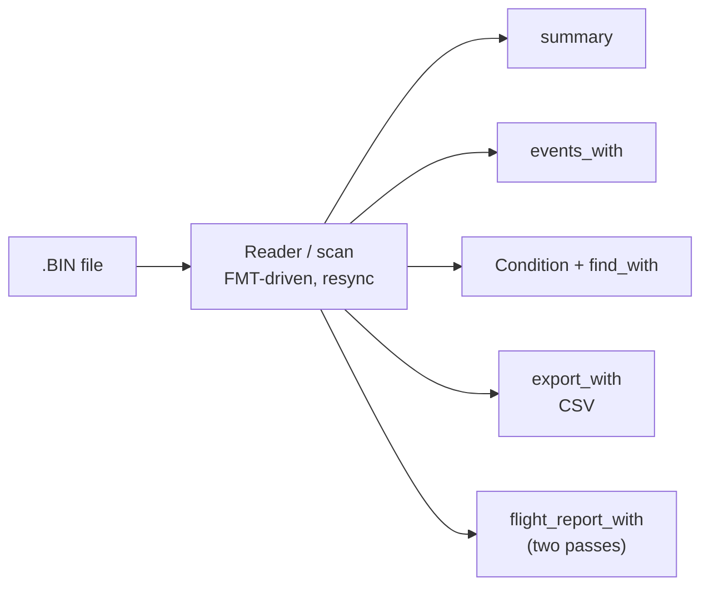

# DataFlash logs: reader, events, search, CSV export

Part of [MARV-GCS](../README.md)

`gcs-dflog` reads ArduPilot DataFlash `.BIN` logs generically, from the file's own FMT records, one record at a time in
constant memory, with progress and cancellation. It has no GUI and no dependency. The Log tab's "Review a log file"
section and `marv-cli log report`, `log tune` and `log survey` use it. The flight report has its own page:
[flight-report](flight-report.md).

## Reader

The file is a sequence of records `A3 95 <type> <payload>`, little-endian. Type 128 is FMT (89 bytes: Type u8, Length u8
(the whole record), Name char[4], Format char[16], Columns char[64]); it defines every other type, so the reader knows
nothing about a particular record. Behaviour follows pymavlink's `DFReader`:

| Rule | Detail |
|---|---|
| Resynchronisation | A record starts at `A3 95` followed by a type whose FMT has been seen; anything else is skipped one byte at a time and counted as bad bytes |
| Truncated tail | An incomplete last record is not an error; its bytes are counted as the tail |
| Fields | Every format character is decoded and scaled as pymavlink does; a field is decoded only when asked |
| Passes | `scan(reader, on_record, on_progress)`; `on_progress` returns `Control::Stop` to cancel. The flight report needs a `Read + Seek` stream (a file or a `Cursor`) because it reads a second time |

Summary (`summary`, one pass): records per type, first and last `TimeUS`, bad and tail bytes, the FMT list, and the
wall-clock start from a `GPS` record with `GWk` above 0.

## Event timeline

`events_with` (also `events`, `events_of`) lists, for a log of the MARV firmware: device state changes, status texts,
parameter changes, GPS fix changes, sticks present, and dropped records. Each `Event` has `time_us`, `source`, `text` and
`initial` (the first record of a source). The Log tab shows time since boot, wall clock, source and text, with a checkbox
per source. Positions are never shown.

## Condition search

A condition is a small expression over the fields of a log's records. `Condition::parse` reads it, `Condition::bind`
resolves the names against the log's FMT list (so a wrong name is an error with its position before any pass), and
`find_with` returns the stretches where it held: start and end `TimeUS`, duration, and the smallest and largest value of
each field the condition names. At most 10 000 intervals are kept (`MAX_INTERVALS`); further ones are counted.

| Write | Meaning |
|---|---|
| `TYPE.Field` | the field of the latest record of that type (any instance) |
| `TYPE[n].Field` | the latest record whose instance field (the first column after `TimeUS` named `I`, `Inst`, `Instance` or `Id`) is `n` |
| `15`, `14.8`, `1e-3` | numbers |
| `+ - * /`, `-x`, `abs(x)` | arithmetic (division by zero is NaN) |
| `< <= > >= == !=` | comparisons, not chained; any comparison with a NaN is false |
| `not`, `and`, `or`, `( )` | logic, in that order of precedence, weakest last |

As in pymavlink, the condition is evaluated after each record of a type it names, over the latest record of each named
type, and is false until every named type has had a record. Examples: `BAT.Volt < 14.8` (low battery),
`IMU[0].AccZ < -15` (a hard knock on the first IMU), `DEV[7].Errs > 100 and GPS.Status < 3` (the radio receiver's error
counter is high while the GPS has no 3D fix). A text field used as a number, or `[n]` on a type without an instance
field, is reported with its position before the pass starts.

## CSV export

`export_with` writes chosen record types as CSV in one pass, optionally at a limited rate and only where a condition holds.
It is for post-processing that other tools do better (a spreadsheet, a plotting script).

| Topic | Rule |
|---|---|
| Files | One per chosen type with at least one row written: `<log name without extension>_<TYPE>.csv` (for example `00000039_IMU.csv`) in the chosen folder, created if needed. A file is created new and never overwritten: if any target exists the export is refused before anything is written, naming the file. A type not in the log, or whose rows were all left out, makes no file. Writes are buffered |
| Cancel or failure | Files written so far are left as they are, each with its header and the rows up to that point; the result or error lists them |
| Format | First line the type's FMT column names; then one line per record, fields as decoded (after scaling), separated by `,`, ended by `\n`. Numbers are the shortest text that reads back to the same value (integers without a decimal point, never an exponent). Text is quoted with `"` when it holds a comma, quote or line break, quotes doubled (RFC 4180). An `a` array is one quoted field of its 32 values joined with `;` |
| Rate limit (Hz) | Per type and instance (a type without an instance field is one instance): a record is kept when none of its type and instance has been kept yet, or when its `TimeUS` is at least `1e6 / rate` microseconds after the last kept one. A type without `TimeUS` is not limited. (mavlogdump's `--reduce-rate` mixes the instances; this does not) |
| Condition | Only records at which the condition holds are written, with the search's semantics: a record that makes it true is written, one that makes it false is not, a record of another type is written while it holds. The condition is applied first, then the rate limit |
| Result | Per type, rows written and records skipped by the rate limit and by the condition, and the file; and whether the pass was cancelled |

## Code

`crates/gcs-dflog/src/`: `reader.rs`, `format.rs`, `summary.rs`, `events.rs`, `condition.rs`, `export.rs`; the flight
report modules are listed in [flight-report](flight-report.md). Folder map: [gcs-dflog](../crates/gcs-dflog/README.md).

## Related

[sessions-and-logs](sessions-and-logs.md) · [flight-report](flight-report.md) · [marv-cli](marv-cli.md) ·
[architecture](architecture.md)
