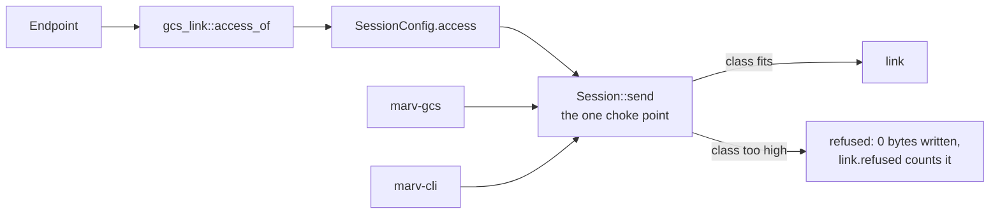

# Link contract: Operate and Configure

Part of [MARV-GCS](../README.md) · [link-contract](link-contract.md), section 9

The station is either a telemetry display and controller (Operate) or also the flight controller's configurator
(Configure). The ground station enforces it, never the firmware: the vehicle answers every station the same way on every
link, and nothing on the wire changes. The gate is the station's alone.

## Roles by link

| Link | Access | Why |
|---|---|---|
| Serial | Configure | A cable to the board: the bench |
| TCP | Configure | Today TCP is the simulator |
| UDP | Operate | A radio or a network: the field |
| Log-file replay | Operate | A recording has no vehicle to configure |

One function, `gcs_link::access_of`, exhaustive over `gcs_transport::Endpoint`, serves the window and the command line;
the transport knows only bytes and `gcs-mavlink` does not know the transport. A session built without an explicit access
is Operate (`SessionConfig::default()`): the gate fails closed.

## Enforcement

`Session::send` is the one choke point. Every `Command` has a class (`Command::access`, one exhaustive `match` with no
wildcard arm, so a new variant cannot be added without one). A configure-class command on an Operate session is refused:
nothing is written (0 bytes) and the refusal is recorded in `VehicleState.link.refused` (what was asked, how many times),
from where a view or the command line shows "refused: this link is operate-only"; the command line exits 4. Configure
sessions pass every command.

| Class | Commands |
|---|---|
| Configure | Every parameter write (`SetParam`); every `SendCommand` except the five flight commands (an unknown `MAV_CMD` id counts as Configure): storage, calibration, device restart and self-test, reboot, motor test; the three log-download commands (`ListLogs`, `DownloadLog`, `CancelLogDownload`), because the vehicle offers log download on its USB link only and the station must not ask for it on a radio or network link |
| Operate | Everything that only reads or concerns the station: the heartbeat (a service), a parameter list request (`RefreshParams`), log recording (`StartLog`, `StopLog`, `StartSessionLog`, `StopSessionLog`), link management, the three mission commands (`UploadMission`, `DownloadMission`, `ClearMission`), and the five flight commands (`Flight(Start, Pause, Abort, Land, Return)`) |

Why the mission and flight commands are Operate-class: in the field the laptop reaches the vehicle through the
transmitter's WiFi backpack, which is the UDP link, and the waypoints made on the Map tab and the flight buttons must work
there. A mission write changes no setting of the vehicle (the list lives in RAM, the station proves every result by reading
it back), and none of the five flight commands arms, disarms or kills; the vehicle refuses them in states the contract does
not allow ([link-flight](link-flight.md)). The mission messages are not `COMMAND_LONG`s. Every parameter write and every
other `SendCommand` stays Configure-class.

Services that run by themselves are not commands and are not gated; they only read: the capability request
(`MAV_CMD_REQUEST_MESSAGE` for `AUTOPILOT_VERSION`) at connect, the repair reads of a list being downloaded, and the
heartbeat.

## Behaviour of the views

- Every configure control is shown disabled with the reason next to it or as hover text ("Configure needs a serial or TCP
  link; this link is operate-only"), never hidden. The Link tab and the connection bar say which role the session has.
- Parameters on an Operate session: the list is not downloaded at connect (the Parameters tab says so); a Refresh the
  user asks for is allowed. An Operate session still shows a `PARAM_VALUE` it did not ask for, so a replayed log fills the
  table: the entry is stored and the status follows the count, but no list is requested and no missing entry is read by
  index. On a Configure session the list is downloaded at connect.
- Radio tab (Calibrate, Apply, mapping edits, Save to flash), Devices tab (calibration buttons, restart, self-test, preset
  Apply, Save, Save and reboot, Custom edits, compass calibration) and Motors tab (Spin, Stop) are Configure controls. The
  debug switch "Debug: raw sensor settings" is the station's own gate: station-local, off at every start, unknown to the
  firmware.

## Code

`crates/gcs-link/src/lib.rs` (`access_of`), `crates/gcs-mavlink/src/state.rs` (`Command::access`, `Command::name`),
`crates/gcs-mavlink/src/session.rs` (`Session::send`), the table test `every_command_has_its_class_in_the_table` in
`session_tests.rs`, and the negative control in `crates/marv-cli/tests/gate.rs`.

## Related

[link-commands](link-commands.md) · [architecture](architecture.md) · [marv-cli](marv-cli.md) · [ui](ui.md)
