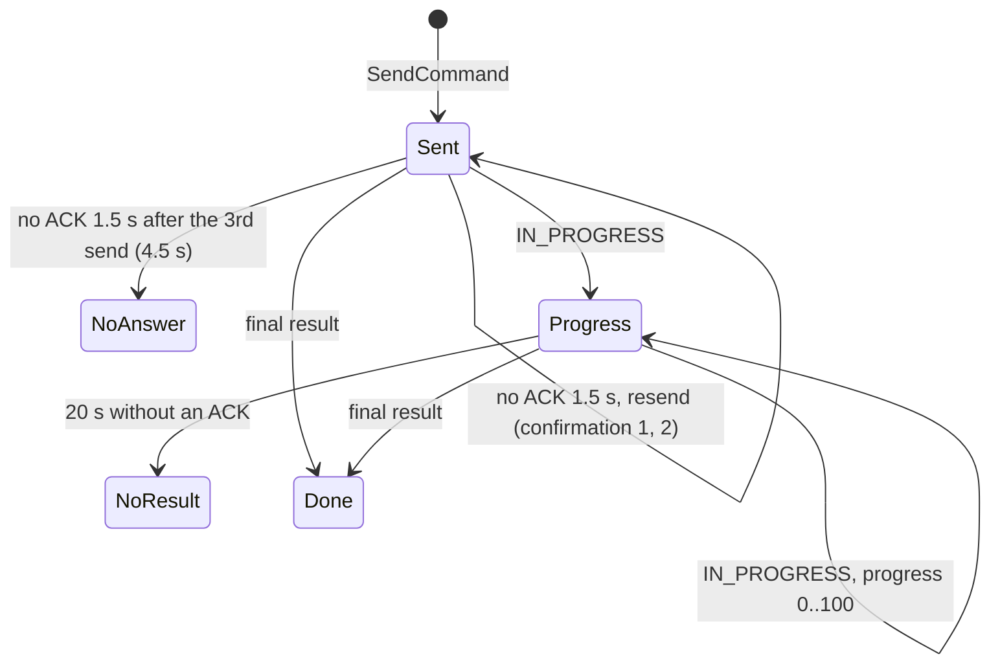

# Link contract: commands and the motor test

Part of [MARV-GCS](../README.md) · [link-contract](link-contract.md), sections 10 and 15

The station sends a MAVLink command only when the user presses a button; it never sends one by itself (the capability
request is a read). Every `Command::SendCommand` is Configure-class except the five flight commands
([link-flight](link-flight.md)); on an Operate session it writes 0 bytes and is recorded in `link.refused`
([link-access](link-access.md)).

## What the vehicle answers

| Case | Answer |
|---|---|
| A `COMMAND_LONG` it does not know | `COMMAND_ACK` UNSUPPORTED |
| Refused by its parameters | DENIED (a `STATUSTEXT` gives the reason) |
| Armed, or another action running | TEMPORARILY_REJECTED |
| An admitted action | `COMMAND_ACK` IN_PROGRESS `progress` 0 at once, then IN_PROGRESS with a percentage about twice a second, then ONE final `COMMAND_ACK` (ACCEPTED, FAILED or CANCELLED) |
| The same command again while it runs (a retransmission) | IN_PROGRESS again, never a rejection |

Every ACK is addressed to the sender: `target_system` and `target_component` are the station's ids. Longest durations:
calibration 15 s (compass 40 s), storage 3 s, device action 5 s, reboot 3 s.

## The commands (`COMMAND_LONG`, parameters not named are 0)

| Command | Parameters |
|---|---|
| 241 `MAV_CMD_PREFLIGHT_CALIBRATION` | param1 = 1: gyro. param5 = 4: accelerometer, one position, level. param2 = 1 and all others 0: compass, quick method (the user rotates the vehicle through all orientations for 30 s; progress about twice a second; FAILED when an axis saw too little movement). All seven 0: cancel the running calibration. Offsets apply at once and are saved only by 245 param1 = 1 |
| 245 `MAV_CMD_PREFLIGHT_STORAGE` | param1: 0 reload from flash (the vehicle sends no `PARAM_VALUE` afterwards), 1 save, 2 all parameters to defaults, 3 sensor calibration parameters to defaults (not the RC end points) |
| 246 `MAV_CMD_PREFLIGHT_REBOOT_SHUTDOWN` | param1 = 1: reboot |
| 42430 `MAV_CMD_MARV_DEVICE` | param1 = device id (`MARV_DEVICE`), param2 = 1 restart, 2 self-test; restart for IMU1, IMU2, BARO, MAG, GNSS, BATT; self-test for IMU1, IMU2, MAG |
| 209 `MAV_CMD_DO_MOTOR_TEST` | Motor test, below; ACCEPTED at once (no IN_PROGRESS) |
| 511, 512 | Message interval and request message ([link-contract](link-contract.md)) |

The quick compass method measures the body-frame raw field, not the field with the calibration in force. On acceptance it
writes together `MAG_OFFX/Y/Z`, S = identity, `MAG_CAL_TYPE` = 1 and `MAG_FLD_UT` = 0 ([link-compass](link-compass.md)).

## What the station does (`gcs-mavlink` service `commands`; state in `VehicleState.command`)

| Rule | Detail |
|---|---|
| One at a time | A second `SendCommand` while one is outstanding is refused: nothing is sent and the outstanding command's record counts it (`refused`: the number and how many). The one exception is the cancel below. A `SendCommand` with no vehicle connected is refused too (state `Refused` with the reason) |
| Send | `COMMAND_LONG` to the vehicle's system and component, `confirmation` 0; with no ACK again after 1.5 s with `confirmation` 1 and after another 1.5 s with 2: three sends at 0, 1.5 s and 3.0 s; 1.5 s after the third, "no answer" (at 4.5 s). A motor-test spin (209 with param3 above 0) is sent once and never again; with no ACK the result is "no answer" 1.5 s after the send. A stop (209 with param3 0) is re-sent like any command |
| Which ACK counts | Its `command` is the outstanding command's number, it is addressed to the station (`target_system` 0 or 255, `target_component` 0 or 190) and comes from the vehicle's system. Any other is ignored |
| IN_PROGRESS | Stops the retransmission; the state follows `progress` (0 to 100; 255 unknown). With no further ACK for 20 s (from the last one) the result is "no result (the vehicle stopped reporting)". It never ends a command |
| Final results | ACCEPTED, TEMPORARILY_REJECTED, DENIED, UNSUPPORTED, FAILED, CANCELLED, COMMAND_LONG_ONLY, COMMAND_INT_ONLY, COMMAND_UNSUPPORTED_MAV_FRAME, NOT_IN_CONTROL, each with its own text. An ACK after the end is ignored. The last command stays in `VehicleState.command` (number, name, parameters, state, sends, start and end) until the next |

## The cancel

While a calibration (241 with a non-zero parameter) is outstanding, a `SendCommand` of 241 with all seven parameters 0 is
sent although the calibration is outstanding. It has its own send count and timers (1.5 s, at most 3 sends) and its own
state in the calibration's record (`cancel`: waiting, answered with a text, no answer). Only one cancel is in play; another
meanwhile is refused. Both are command 241, so the number cannot tell their ACKs apart. The vehicle answers the cancel at
once with ACCEPTED (DENIED when no calibration runs) and ends a cancelled calibration with a final CANCELLED. The station
reads them in order:

1. From the moment a cancel is sent the calibration command is never sent again; nothing is sent but the cancel's own sends.
2. While a cancel is in play, ACKs for 241 are read in order. IN_PROGRESS is the calibration's progress. CANCELLED ends the
   record "cancelled". The first other result R1 is held as "the answer so far" (the cancel's state `answered`) and the
   cancel is not sent again. A second other result R2 decides: if R2 is DENIED the calibration had finished by itself with
   R1, and the record ends with R1's text and "finished before the cancel"; any other R2 ends the record with R2's text.
3. If only R1 arrived: 3 s after it, with no CANCELLED and no second result, the record ends. R1 ACCEPTED: "cancel accepted,
   no final result"; R1 DENIED: "nothing to cancel"; any other R1: R1's text. Progress ACKs do not extend the 3 s.
4. If the cancel gets no ACK after its 3 sends, its state is "no answer" and the calibration goes on being followed by its
   20 s rule, without being sent again.
5. In every case the record ends and the buttons come back; a cancel still waiting when the calibration ends is dropped.

## Motor test (command 209)

Propellers off only. One motor at a time, no mixer, no arming.

| Param | Meaning |
|---|---|
| param1 | Motor 1 to 4 (M1 to M4, the `ESC_STATUS` order: M1 GPIO39, M2 GPIO38, M3 GPIO37, M4 GPIO36) |
| param2 | 0 (percent) |
| param3 | Throttle 0 to 5.0 % (0 = stop now) |
| param4 | Duration above 0 up to 3.0 s (ignored for a stop) |
| param5 | 0 or 1 |
| param6 | 0 or 2 (board order) |
| param7 | 0 |

The level sent to the ESC is round(param3 x 20) of 2000, at least 1. Answers: ACCEPTED at once, and the spin runs for
param4 (never more than 3 s from its first frame). A spin command while one runs replaces it (the earlier motor gets Stop).
A stop is always ACCEPTED and ends the spin within one exchange (1 ms). DENIED (with a `STATUSTEXT`): a parameter outside
the table. TEMPORARILY_REJECTED: another action running; while a spin runs every other action-starting command is
TEMPORARILY_REJECTED. The firmware does not check the ESCs or the battery before a spin, does not end a spin on telemetry
and has no repeat-to-hold: if the link drops the spin runs to its end. The other three motors get Stop throughout. The
firmware answers 209 on every link; the station sends it only on a Configure session, only from the Motors tab with the
"propellers are removed" switch on (Stop needs no switch).

## The simulator

`gcs-sim` behaves as above: admitted commands get IN_PROGRESS 0 at once, IN_PROGRESS with the percentage every 500 ms and
ACCEPTED after 2 s (a calibration after 3 s, the compass calibration after 4 s; a cancel ends it CANCELLED); one action at
a time (another command: TEMPORARILY_REJECTED, the same again: IN_PROGRESS). DENIED: 245 with param1 other than 0 to 4, 246
with param1 other than 1, 241 with other parameters (param1 = 1 and param2 = 1 together too), 42430 with a device or action
not listed. Any other command except 512: UNSUPPORTED. Two switches, off by default: drop the first N `COMMAND_LONG`s that
are not `MAV_CMD_REQUEST_MESSAGE`, and never send the final ACK. Command 209 shows rpm = level x 18.6 on the tested motor
for the duration. It reads and writes 42430 by hand, as it does `MARV_DEVICE_STATUS`.

Not in the command service: `COMMAND_INT`, a queue of commands, arming, automatic commands.

## Related

[link-access](link-access.md) · [link-flight](link-flight.md) · [link-compass](link-compass.md) ·
[ui-tabs](ui-tabs.md) (Motors) · [ui-radio-devices](ui-radio-devices.md)
