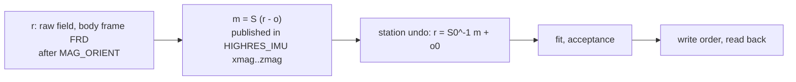

# Link contract: compass calibration

Part of [MARV-GCS](../README.md) · [link-contract](link-contract.md), section 16

The parameters, the model, a test vector, what the vehicle publishes, the write order and the calibration state. The guided
procedure (poses, fit, acceptance) is a station feature ([gcs-magcal](../crates/gcs-magcal/README.md),
[ui-radio-devices](ui-radio-devices.md)); another station needs only what is on this page.

## Parameters

All Live (applied at once, saved only by command 245 param1 = 1). Indices 81 to 91 follow `LED_BRIGHT` and `GPS_RATE_MS` in
the set of [link-parameters](link-parameters.md). Command 245 with param1 = 3 returns the "calibration" parameters (81 to
89, and `MAG_OFF*`) to their defaults.

| Index | Name | Type, unit | Default | Range | Reset by calibration reset |
|---|---|---|---|---|---|
| 81 | `MAG_DIAGX` | F32 | 1.0 | 0.2..5.0 | yes |
| 82 | `MAG_DIAGY` | F32 | 1.0 | 0.2..5.0 | yes |
| 83 | `MAG_DIAGZ` | F32 | 1.0 | 0.2..5.0 | yes |
| 84 | `MAG_ODIAGXY` | F32 | 0.0 | -1.0..1.0 | yes |
| 85 | `MAG_ODIAGXZ` | F32 | 0.0 | -1.0..1.0 | yes |
| 86 | `MAG_ODIAGYZ` | F32 | 0.0 | -1.0..1.0 | yes |
| 87 | `MAG_CAL_TYPE` | I32 | 0 | 0..2 (0 none or unknown, 1 quick, 2 guided) | yes |
| 88 | `MAG_FLD_UT` | F32, uT | 0.0 | 0..95 (0 = not set) | yes |
| 89 | `MAG_FLD_INC` | F32, deg | 0.0 | -90..90 (positive down; meaningful only when `MAG_FLD_UT` > 0) | yes |
| 90 | `MAG_HLT_STR` | F32, % | 10 | 1..50 | no |
| 91 | `MAG_HLT_INC` | F32, deg | 10 | 1..45 | no |

`MAG_OFFX/Y/Z` keep their earlier index, range (-200..200 uT) and meaning.

## Model

m = S (r - o), all in microtesla. r is the magnetometer's field in the body frame (FRD) after `MAG_ORIENT`; o = (`MAG_OFFX`,
`MAG_OFFY`, `MAG_OFFZ`); S is symmetric:

    [[DIAGX,   ODIAGXY, ODIAGXZ],
     [ODIAGXY, DIAGY,   ODIAGYZ],
     [ODIAGXZ, ODIAGYZ, DIAGZ  ]]

In single precision, in this order: d = r - o; m_i = (S_i0 d_0 + S_i1 d_1) + S_i2 d_2, with no fused multiply-add. With
the defaults (S = identity) the result equals r - o. The sign convention is PX4's (offsets are subtracted); ArduPilot adds
its offsets, so an ArduPilot offset must be negated when ported.

**Test vector.** Both ends test against it: the firmware bit for bit, the station's undo within 1e-4 uT.

| Item | Value |
|---|---|
| S | DIAGX 1.0625, DIAGY 0.9375, DIAGZ 0.78125; ODIAGXY 0.03125, ODIAGXZ -0.046875, ODIAGYZ 0.0625 |
| o | (-14.2, -4.2, 1.5) as f32 = 0xC1633333, 0xC0866666, 0x3FC00000 |
| r | (20.5, -3.25, 38.0) = 0x41A40000, 0xC0500000, 0x42180000 |
| d = r - o | 0x420ACCCD, 0x3F733330, 0x42120000 |
| m | (35.1875, 4.2562499..., 26.9484367...) = 0x420CC000, 0x40883333, 0x41D79666 |

## What the vehicle publishes

The magnetometer fields of `HIGHRES_IMU` `id` 0 carry m: the field with the calibration in force applied (offsets and S).
The unit stays gauss (1 gauss = 100 uT).

## The station's undo

For each sample, r = S0^-1 m + o0, with S0 and o0 read at the start of the run. If S0 is not positive definite the station
refuses to start. If any of `MAG_OFF*` or 81 to 86 changes during the run (a `PARAM_VALUE` is seen) the run is abandoned.
The station refuses to start, or stops, when `HEARTBEAT` shows armed.

## Write order (the commit)

1. `MAG_CAL_TYPE` = 0.
2. `MAG_OFFX/Y/Z`, `MAG_DIAGX/Y/Z`, `MAG_ODIAGXY/XZ/YZ`, `MAG_FLD_UT`, `MAG_FLD_INC`.
3. `MAG_CAL_TYPE` = 2.
4. Read all of them back and compare.

Save (245 param1 = 1) only after a good read-back. If the link drops during the write, the vehicle holds a mixed set marked
type 0, in RAM only: Discard (245 param1 = 0) or a reboot restores flash.

## Calibration state, as both ends read it

| State | Condition |
|---|---|
| Not calibrated | `MAG_CAL_TYPE` 0 and `MAG_OFFX/Y/Z` all zero |
| Best effort | Type 1, or type 0 with non-zero offsets |
| Guided | Type 2 with `MAG_FLD_UT` > 0 |

Health-test data: field strength is compared with `MAG_FLD_UT` x (1 ± `MAG_HLT_STR` / 100) and the inclination (positive
down) with `MAG_FLD_INC` ± `MAG_HLT_INC`. With `MAG_FLD_UT` = 0 the test is unavailable. What the flight code does with this
is not part of the link contract.

The quick method (command 241 param2 = 1, [link-commands](link-commands.md)) measures the body-frame raw field and, on
acceptance, writes together `MAG_OFFX/Y/Z`, S = identity, `MAG_CAL_TYPE` = 1 and `MAG_FLD_UT` = 0.

## The simulator

`HIGHRES_IMU`'s `xmag`, `ymag`, `zmag` follow m = S (r - o) / 100 gauss with S and o from the parameters (single
precision, the contract's order) and r = S_true^-1 (R B) + o_true + noise + magnet, where B is the World Magnetic Model
(`gcs-magcal`) at the simulator's position and date and R the attitude (body from NED). Level, facing north, with the
default calibration it reads the model field there (about 21.5, 1.4, 43.3 uT). `SimConfig::mag` holds `S_true`, `o_true`,
the noise, a magnet and an anomaly site; `SimConfig::user` is a scripted user who holds each of the six poses and makes one
12 s turn about the vertical (`skipping(pose)` leaves one out); `SimVehicle::set_silent` and `set_armed` do the rest. The
quick calibration ends by writing `o_true`, S = identity, `MAG_CAL_TYPE` 1 and `MAG_FLD_UT` 0. Tests:
`crates/gcs-sim/tests/compass.rs`, six end-to-end runs through `gcs_magcal::session::Session`.

## Related

[link-parameters](link-parameters.md) · [ui-radio-devices](ui-radio-devices.md) · [gcs-magcal](../crates/gcs-magcal/README.md)
