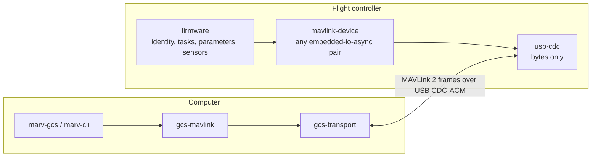

# Link contract: flight controller and ground station

Part of [MARV-GCS](../README.md)

What the vehicle and the station must each do on the wire. Both ends are built from this text: the firmware
([MARV-FC](https://github.com/Lmx154/MARV-FC), through [mavlink-device](https://github.com/Lmx154/mavlink-device) and
[usb-cdc](https://github.com/Lmx154/usb-cdc)), the station and the simulator `gcs-sim`. It is split into pages; the
section numbers below are the ones code comments cite.

The computer needs no driver: Linux, Windows and macOS show CDC-ACM as a serial port. USB lives alone (`usb-cdc` never
names MAVLink); MAVLink is a layer on top of it.

## Pages and sections

| Section | Topic | Page |
|---|---|---|
| 2 | Identity, heartbeat, streams, rates (this page); parameter protocol and the parameter set | [link-parameters](link-parameters.md) |
| 3, 4 | The USB crate, the start gate, the device layer | [link-usb](link-usb.md) |
| 5 | Invariants | this page |
| 8, 12, 14, 18 | `MARV_DEVICE_STATUS`, RC mapping and `MANUAL_CONTROL`, ESC telemetry, position marks (`MARK` texts) | [link-telemetry](link-telemetry.md) |
| 9 | Operate and Configure | [link-access](link-access.md) |
| 10, 15 | Commands, calibration cancel, motor test | [link-commands](link-commands.md) |
| 10 (flight) | Flight commands, effective mode, deny codes, take-over panel | [link-flight](link-flight.md) |
| 11 | Log download | [link-logs](link-logs.md) |
| 13 | Sensor presets | [link-presets](link-presets.md) |
| 16 | Compass calibration | [link-compass](link-compass.md) |
| 17 | Missions | [link-missions](link-missions.md), [examples](link-missions-examples.md) |

## 2. Wire contract

### Identity and heartbeat

| Item | Rule |
|---|---|
| Vehicle ids | System 1, component 1 |
| Station ids | System 255, component 190 |
| Vehicle `HEARTBEAT` | 1 Hz, not changeable. Type GENERIC, autopilot GENERIC, `base_mode` 0, `system_status` set by the firmware (BOOT, then STANDBY), `mavlink_version` 3. `custom_mode` is the effective mode ([link-flight](link-flight.md)); 0 means the vehicle reports none |
| Station `HEARTBEAT` | 1 Hz: type GCS, autopilot INVALID, `base_mode` 0, status ACTIVE; the first is sent at once after the port is open and configured |
| Lost | Each end calls the other lost after 5.0 s without its `HEARTBEAT`; a transport error is lost at once |
| Framing | MAVLink 2 only. The vehicle drops MAVLink 1 frames, frames with any incompat flag, frames with its own system id and frames addressed to another target. No signing |

### Streams

What the real firmware sends on its USB port (the simulator's default streams are the same; the Sensors and Radio tabs
read them):

| Message | Rate | Notes |
|---|---|---|
| `HIGHRES_IMU` (105) `id` 0 | 25 Hz | IMU1; the magnetometer in `xmag`/`ymag`/`zmag`, in gauss |
| `SCALED_IMU2` | 25 Hz | IMU2 in mG and mrad/s. The gyro fields are int16 mrad/s and saturate at ±32.767 rad/s (about 1877 dps), so a faster rate shows as that limit in IMU2's Flight and Max range presets; `HIGHRES_IMU` and the log carry the full range |
| `SCALED_PRESSURE` | 25 Hz | |
| `SYS_STATUS`, `GPS_RAW_INT` | 1 Hz | |
| `RC_CHANNELS` | 5 Hz | while the receiver delivers sticks |
| `ESC_STATUS` (291) 10 Hz, `ESC_INFO` (290) 1 Hz | | USB only; [link-telemetry](link-telemetry.md) |
| `MANUAL_CONTROL` (69) | 5 Hz (fastest 50 Hz) | USB only, only while a CRSF stick report is younger than 1 s |
| `MARV_DEVICE_STATUS` | every device at least once a second on USB | [link-telemetry](link-telemetry.md) |

Frame of reference: every IMU and magnetometer field is in the vehicle's body frame, FRD (x forward, y right, z down),
after the firmware's rotation (`AHRS_ORIENTATION`, `MAG_ORIENT`) with the calibration offsets removed. Level and at rest the
accelerometer's z reads about -9.81 m/s² (`SCALED_IMU2` about -1000 mG).

The station shows `ATTITUDE` in its HUD when the vehicle sends it; the firmware does not send it yet and the simulator
sends it at 10 Hz as a test double. The `mavlink-device` demonstration program (used by `tools/board_check.sh` and
`crates/marv-gcs/tests/board.rs`) is not the contract: it sends `HIGHRES_IMU` with one instance per sensor in `id` at
50 Hz (ICM-45686, LSM6DSK320X low-g, high-g, BMM350; a field the sensor does not measure is NaN with its
`fields_updated` bit clear), `SCALED_PRESSURE` at 10 Hz and `GPS_RAW_INT` at 5 Hz. Plot series are therefore keyed by
(message, instance) and NaN points are skipped.

### Rates and commands

- Sent unasked: `HEARTBEAT`, the default streams and `STATUSTEXT`, from the moment the link task lets the vehicle
  transmit: from boot on a link with no open (UART, radio), on USB from the start gate ([link-usb](link-usb.md)).
- `MAV_CMD_SET_MESSAGE_INTERVAL` (511) as `COMMAND_LONG`: -1 off, 0 default; faster than the stream's minimum, slower than
  10 s, an id not in the table, `HEARTBEAT` or param3 != 0 get DENIED. Rates live in RAM and return to defaults when the
  link goes down. `MAV_CMD_REQUEST_MESSAGE` (512): ACK, then one copy.
- The vehicle answers only the commands of [link-commands](link-commands.md) and [link-flight](link-flight.md); every other
  command gets UNSUPPORTED. The device layer never arms, never changes a mode and does nothing when the station is lost.

### Dialect

Both ends build messages from byte-identical MAVLink XML with generator 0.21.0 and extension fields on, through
[marv-dialect](https://github.com/Lmx154/marv-dialect). It holds `common` and, as a second module, `marv` (`common` plus
`marv.xml`): `MARV_TEST` (id 42420, CRC_EXTRA 100, a link test message) and `MARV_DEVICE_STATUS` (id 42421, CRC_EXTRA
231). The station's `dialect` alias is `marv_dialect::marv` (with the `serde` feature the Messages tab reads fields
through). The station also keeps `mavlink = "=0.21.0"` with `mav2-message-extensions` for framing helpers, and `gcs-sim` is
written on that crate's `common`. Adding a message: [extending](extending.md).

### Not on the link

TIMESYNC; parameter metadata (the station holds a table of the firmware's parameters, `gcs_mavlink::param_info`, the link
carries none); signing; parameter types beyond INT32 and REAL32; per-instance rates; radio calibration of channels 9 to
16; chip filters in the sensor presets; IMU rates above 800 Hz; `PARAM_VALUE` for values the vehicle changes itself (so the
station reads them back); the running IMU configuration.

## 5. Invariants

1. A lower layer never names a higher one (`cargo tree` checks at both ends).
2. No USB IN chunk of 64 bytes or more; `read` never returns `Ok(0)` for a non-empty buffer; no `usb-cdc` call waits while
   the link is down.
3. On the flight controller only the link task awaits a `usb-cdc` or `mavlink-device` future. Sensor and control tasks
   hand values over through non-blocking latest-value cells.
4. Both ends generate from byte-identical MAVLink XML with generator 0.21.0 and extension fields on (the lock-step test in
   `marv-dialect`; `cargo tree -e features -i mavlink` in the station shows v0.21.0 with `mav2-message-extensions`). A
   version bump is one change across both, gated by that test.
5. Only INT32 and REAL32 parameters; the set is fixed per boot.
6. The device layer never arms, never changes a mode, has no failsafe.
7. Default streams at their fastest stay within 25 % of the measured USB throughput.
8. On USB nothing is written between link-up and the start gate; after an enumeration the first byte a reader gets is the
   0xFD of a whole frame. This is a rule of the USB link task, not of the wire: a station must still resynchronise at the
   start of any session (a USB-serial adapter has the same cooked window and the vehicle cannot see it).
9. `MANUAL_CONTROL` from the vehicle is a report: the firmware acts on no inbound `MANUAL_CONTROL` or
   `RC_CHANNELS_OVERRIDE`, and nothing in the firmware reads the normalised sticks except its encoder.
10. Only CRSF stick reports feed `MANUAL_CONTROL`.

## Related

[architecture](architecture.md) · [link-parameters](link-parameters.md) · [extending](extending.md)
