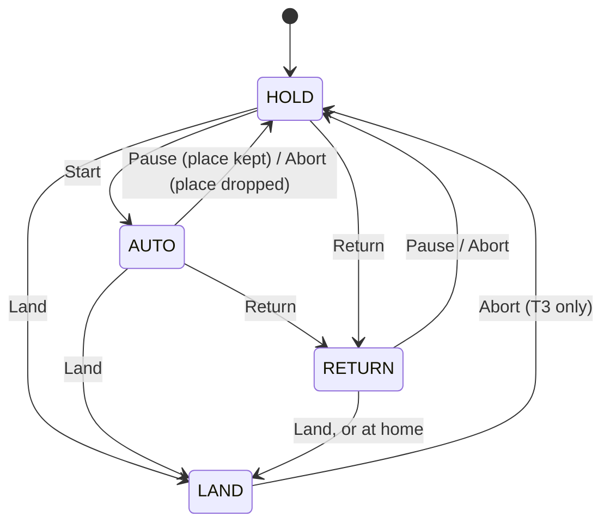

# Link contract: flight commands and the effective mode

Part of [MARV-GCS](../README.md) · [link-contract](link-contract.md), section 10

Five buttons (Start, Pause, Abort, Land, Return) and the vehicle's effective mode in `HEARTBEAT` `custom_mode`. It binds the
firmware, the station and `gcs-sim`. None of the five arms, disarms or kills, whatever its parameters. They are
Operate-class ([link-access](link-access.md)), travel on the radio link (the station's UDP link through the backpack), and
the vehicle's deny rules apply to each. The Map tab's controls: [ui-map](ui-map.md).

## Effective mode (`custom_mode`, a value not a bitfield, on every link)

| Code | Mode | The vehicle |
|---|---|---|
| 0 | not reported | The station shows no mode |
| 1 | PILOT | A fresh CRSF report and the pilot latch set: the flight modes of the CRSF model |
| 2 | TAKEOVER | Mission switch OFF on a MAVLink flight: control stays locked until arm ON and the mode switch in Position have been seen; then the pilot flies in Position. For a flight armed on the CRSF model: a fresh CRSF report in HOLD, AUTO, RETURN, LAND or BLIND makes the vehicle hold with centred sticks until the same arm and mode-switch conditions are seen in fresh reports. RC lost again in TAKEOVER: HOLD, LAND or BLIND by tier, and the lock starts over |
| 3 | HOLD | Hands-off Position hold, centred sticks, after the mission switch ON |
| 4 | AUTO | Flying the stored list ([link-missions](link-missions.md)) |
| 5 | RETURN | Climbing to the return height, then a straight leg home |
| 6 | LAND | Descending to touchdown, then disarm |
| 7 | STOP | Disarmed, motors stopped |
| 8 | BLIND | Level descent with no height estimate (position tier T1) |

Codes 9 and above are not assigned (a station shows "unknown" and the number). With `FS_HOLD_EN` 0, and on every flight
armed on the CRSF model, the vehicle sends PILOT and STOP, and after a loss of the stick reports also LAND, BLIND and
TAKEOVER (a stick loss in the air starts a descent in every configuration); HOLD, AUTO and RETURN stay unreachable with
`FS_HOLD_EN` 0. The station shows the effective mode from the `HEARTBEAT`, not from an ACK.

## The commands

`COMMAND_LONG`; parameters not named are 0.

| Button | Command | Parameters | Taken in | Then |
|---|---|---|---|---|
| Start | 300 `MAV_CMD_MISSION_START` | all 0 (ignored) | HOLD, with every Start condition below | AUTO: from the kept place, else from `seq` 0 |
| Pause | 193 `MAV_CMD_DO_PAUSE_CONTINUE` | param1 0 | AUTO; RETURN | HOLD; from AUTO the place is kept |
| Abort | 176 `MAV_CMD_DO_SET_MODE` | param1 1 (`MAV_MODE_FLAG_CUSTOM_MODE_ENABLED`), param2 3 (HOLD) | AUTO; RETURN; LAND on T3 only | HOLD, the place dropped |
| Land | 176 `MAV_CMD_DO_SET_MODE` | param1 1, param2 6 (LAND) | HOLD; AUTO; RETURN | LAND |
| Return | 20 `MAV_CMD_NAV_RETURN_TO_LAUNCH` | all 7 parameters 0 | HOLD; AUTO (in RETURN: ACCEPTED, no effect) | RETURN, the place dropped, the return height latched |

Only these: the same commands with other parameters, and every other `MAV_CMD`, stay Configure-class. The station sends
them as any command ([link-commands](link-commands.md): one outstanding, three sends 1.5 s apart, the first ACCEPTED or
DENIED ends one); `FlightCommand::wire` and `from_wire` in `gcs-mavlink/src/flight.rs` are the table above.

## What the vehicle answers

One `COMMAND_ACK` at once, addressed to the sender: ACCEPTED when it takes the command (the state changes at the step it is
taken), otherwise DENIED; never IN_PROGRESS, TEMPORARILY_REJECTED or FAILED. DENIED when any of these holds:

1. The vehicle is in a state the table does not give for that command: PILOT, TAKEOVER and STOP for all five (code 4), and
   every state with `FS_HOLD_EN` 0. (Fresh stick reports do not refuse a command on a MAVLink flight.)
2. The parameters differ from the table: Pause with param1 other than 0 (continue is not served: Start resumes);
   `MAV_CMD_DO_SET_MODE` with param1 other than 1 or param2 other than 3 or 6.
3. Start only, also in HOLD, unless all of these hold:

| Order | Condition | Code on failure |
|---|---|---|
| 1 | The station is present on the radio link: a station `HEARTBEAT` received on the radio within 10.0 s (a USB heartbeat does not count) | 5 |
| 2 | A list with waypoints is stored: `count` 2 or more (`count` 1 is the return item alone) | 6, or 20 when a mission is stored but `GDN_SRC` is 0 |
| 3 | Home is set (its height at the arming step, its position at the first armed step with a position, before take-off; cleared at disarm) | 8 |
| 4 | The vehicle and every stored waypoint are at most 1000 m horizontally from home (checked at every Start and nowhere else; a waypoint at 1000.5 m or a vehicle at 1001 m is refused) | 9, 10, 11 |
| 5 | Position tier T3 (the position is covered) | 13 |
| 6 | The heading monitor reports OK | 12 |
| 7 | The battery is not critical | 17 |
| 8 | A receiver report younger than 1.0 s with the mission switch (channel 8) ON; then arm ON in it; then the mode switch in Position in it | 19, then 15, then 16 |

Return is DENIED in this order: the checks common to all five (the radio link, hands-off enabled, the state), then no home
(8), then position or heading tier lost (13), then battery critical (17). Already within `GDN_RADIUS` of home: ACCEPTED
(RETURN goes to LAND at the next step, the intended end of a return).

## Deny reason codes

Every DENIED `COMMAND_ACK` carries a reason in `result_param2` (0 = unknown). The vehicle's `DenyReason::code()` and this
table must agree; the station shows the text of the code, then ": " and the pressed button with " refused" (code 11 on
Start: "A waypoint is more than 1 km from the take-off point: Start refused"). A code not in the table: "Refused, reason not
known (code N): <button> refused".

| Code | Reason | Text the station shows |
|---|---|---|
| 0 | unknown | "Refused, no reason given" |
| 1 | not the radio link | "Not on the radio link: connect through the transmitter's WiFi backpack" |
| 2 | the flight is on the CRSF model | "The transmitter is on the CRSF model: missions fly on the MAVLink model only" |
| 3 | hands-off not enabled, or the flight was armed on the CRSF model | "Hands-off flight is off: FS_HOLD_EN is 0, or this flight was armed on the CRSF model" |
| 4 | not in this state | "The vehicle is not in a state that takes this command" |
| 5 | station heartbeat absent | "The vehicle does not hear this station on the radio link: check the link and try again" |
| 6 | no waypoints stored | "No waypoints are stored on the vehicle: upload a mission first" |
| 7 | a stored height outside the limits in force | "A stored height is outside the height limits in force: upload the mission again" |
| 8 | no home | "The vehicle has no home point: it is set at arming, before take-off" |
| 9 | vehicle beyond 1000 m | "The vehicle is more than 1 km from the take-off point" |
| 10 | waypoint distance unknown | "The distance to a waypoint is unknown: the vehicle has no valid position" |
| 11 | waypoint beyond 1000 m | "A waypoint is more than 1 km from the take-off point" |
| 12 | heading not OK | "The vehicle's heading is not OK: wait for it to settle" |
| 13 | position tier lost | "The vehicle has lost its position estimate" |
| 14 | battery not OK | "The battery is not OK" |
| 15 | arm switch off | "The arm switch is OFF" (on Abort: "The arm switch is OFF: the landing continues") |
| 16 | mode switch not in Position | "The mode switch is not in Position" |
| 17 | battery critical | "The battery is critical" |
| 18 | link lost | "The link to this station was lost for more than 10 s" |
| 19 | mission switch not confirmed ON | "The mission switch (channel 8) is not confirmed ON: no live stick report with it ON" |
| 20 | a mission is stored but `GDN_SRC` is not 1 | "The vehicle holds a mission but is set to ignore it (GDN_SRC is 0): set GDN_SRC to 1 in Parameters, then Start again" |

## Stopping the motors

No command arms, disarms or kills. In the MAVLink model the arm switch does not reach the vehicle and there is no laptop
kill. Before arm ON has been seen in TAKEOVER an arm-OFF report does not stop the motors in the air; after arm ON has been
seen, arm OFF disarms at once, and with the airborne latch false arm OFF disarms at once. The quickest stop is the
transmitter's model change back to CRSF, then arm ON, then arm OFF; the model change itself is never blocked.

## Take-over panel

The station shows a standing panel while the latest `HEARTBEAT` `custom_mode` is TAKEOVER, HOLD, AUTO, RETURN, LAND or
BLIND (2, 3, 4, 5, 6, 8), and a full-width panel when the heartbeat stops while the last reported mode was one of those. It
must not claim any switch position. The wording is in [ui-map](ui-map.md#flight-commands).

## Related

[link-missions](link-missions.md) · [link-commands](link-commands.md) · [link-access](link-access.md) · [ui-map](ui-map.md)
