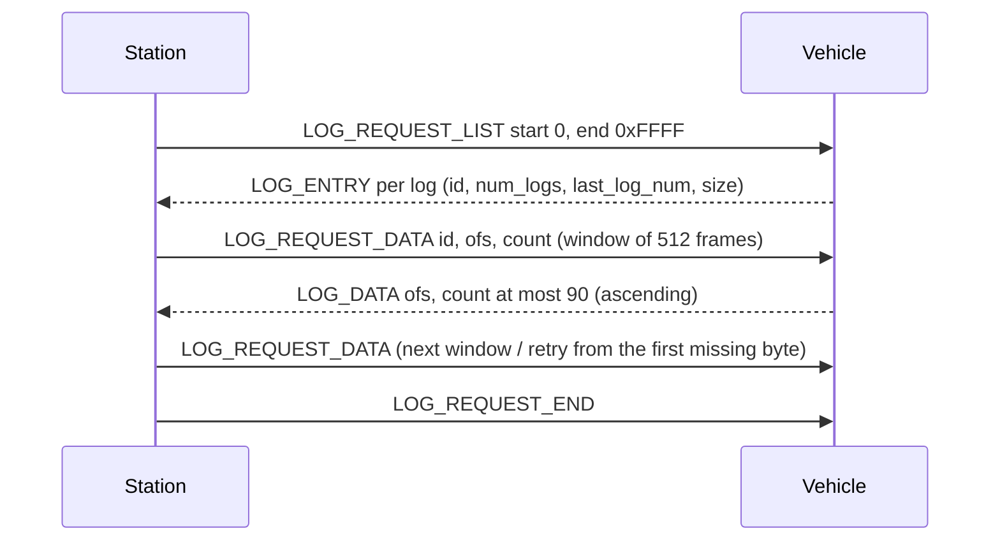

# Link contract: log download

Part of [MARV-GCS](../README.md) · [link-contract](link-contract.md), section 11

ArduPilot's MAVLink log download, with the messages of `common` unchanged. The firmware serves it; the station
(`gcs-mavlink` service `logs`, the Log tab, `marv-cli logs list` and `logs get`) and `gcs-sim` follow it. No new parameter,
no new MARV message, no dialect change.

Messages: `LOG_REQUEST_LIST` 117, `LOG_ENTRY` 118, `LOG_REQUEST_DATA` 119, `LOG_DATA` 120, `LOG_REQUEST_END` 122.
`LOG_ERASE` 121 is not served. The three requests carry `target_system` and `target_component`: the vehicle's ids (1 and
1) as the station learned them from its heartbeat.

## Where

On the vehicle's USB link only: the radio's node does not list these ids, so a request there is dropped. The station treats
log download as Configure-class ([link-access](link-access.md)): it asks for it on a serial or TCP link and refuses it on
UDP with its usual message and exit status 4, nothing written. The vehicle checks nothing; the station enforces.

## Listing

The station sends `LOG_REQUEST_LIST` with `start` 0 and `end` 0xFFFF. The vehicle answers one `LOG_ENTRY` per existing log
whose number lies in `start..=end`, in ascending order:

| Field | Rule |
|---|---|
| `id` | The log's number on the card, 1 to 500. Numbers have gaps (a deleted log leaves one); the station never assumes they are contiguous |
| `num_logs` | How many logs exist on the card (not how many are in the range) |
| `last_log_num` | The number of the log being written, or the highest present when none is open |
| `time_utc` | 0 (the card has no clock; the wall-clock time is in the log's GPS records) |
| `size` | Bytes. For the log being written, the size as of its last flush: it grows, at most about 1 s behind |

Special cases:

- A mounted card with no logs: ONE `LOG_ENTRY` with `id` 0, `num_logs` 0, `last_log_num` 0, `size` 0. The station reads it
  as an empty list.
- No card, or the vehicle's SD row not OK (starting, recovering, clean-up before a log opens, logging off): the vehicle
  does NOT answer (an "empty list" would be a wrong answer while logs exist but cannot be reached). The station's listing
  ends with "no answer"; the Devices tab says why.
- A `LOG_REQUEST_LIST` during a download replaces the transfer (one activity at a time). A range with no log in it, on a
  card that has logs: nothing is sent (the station asks only for all).

## Download

The station sends `LOG_REQUEST_DATA` (`id`, `ofs`, `count`). The vehicle answers with `LOG_DATA` (`id`, `ofs`, `count` at
most 90, `data`) in ascending offset order for the bytes `ofs .. ofs + count`, clamped to the log's size at the time of
the request; a `count` of 0xFFFFFFFF, or one that goes past the end, means "to the end".

| Case | Vehicle |
|---|---|
| Another `LOG_REQUEST_DATA` for an existing log | Replaces the running transfer |
| `ofs` at or past the end of an existing log | ONE `LOG_DATA` with `count` 0 (ArduPilot's end marker); the station never waits for it |
| A log that does not exist | NO `LOG_DATA` at all, not even a marker: for the station the same as a silent vehicle |
| `LOG_REQUEST_END` | Stops the running transfer. A transfer also stops when the station's `HEARTBEAT` has not been seen for 3 s, or the link goes down |

MAVLink 2 cuts the trailing zero bytes of a payload: the station reads `count`, never the payload length, and treats what
was cut as zeros.

## Pace and the station's rules

The vehicle sends `LOG_DATA` through a stream slot of its node: at most 4 frames per 5 ms, about 72 kB/s (a 161 MB log takes
about 37 minutes at best).

| Rule | Detail |
|---|---|
| Window | One outstanding request: 512 frames (46 080 bytes) from the first missing offset, or what is left of the size. When every byte of the window is in, the next is requested |
| Out of order | A frame that repeats what is in, or arrives out of order inside the window, is tolerated (held until its turn); a frame of another log id, another system, with count 0, or beyond the window is ignored |
| Retry | Progress is the first missing offset moving. When it has not moved for 1 s after the last request or move, ask again from the first missing offset. After 5 retries of the same offset, 1 s after the fifth (6 s of silence from the first request) it gives up: "no data from the vehicle at byte N after 5 new requests", and sends `LOG_REQUEST_END`. A move of the offset starts the count again |
| Complete | Every byte up to the `size` of the `LOG_ENTRY` it started from has arrived, never by waiting for a zero-count `LOG_DATA`. A log that grew after the listing is not a failure; a log of size 0 is complete at once and nothing is requested |
| End | `LOG_REQUEST_END` is sent when a download is given up or cancelled, and when the file cannot be written |
| Link closes | The session ends the download at once as failed ("link lost at byte N"); nothing is sent |
| Listing | Waits 1 s for a new `LOG_ENTRY`, then asks again for all logs, 4 requests in all, entries already in are kept; ends when `num_logs` different entries are in, or fails ("only N of M log entries arrived", or no answer) one second after the fourth request |

Logging continues during a download; the log being written can be listed and downloaded up to its flushed size. Not
offered: erase; a download while a log clean-up or a card recovery runs (the request is not answered; the station's retries
cover a short one).

## What the station does

- `Command::ListLogs` starts a listing; the result is `logs.list` (`Done` with the logs and `last_log_num`, or `Failed`).
- `Command::DownloadLog { number, size, sink }` starts the download of one log, `size` taken from a listing, to a writer the
  caller opened (`LogSink`): bytes are handed to it in order as they come, so a log is never held in memory; progress is
  `logs.download.done` of `size`. `Command::CancelLogDownload` ends it. The writer is dropped when the download ends,
  whatever the end.
- The window's writer fills `NNNNNNNN.BIN.part` and renames it to `.BIN` only when exactly `size` bytes were written and
  flushed, otherwise deletes it; `marv-cli` writes its file directly and keeps a partial one.
- One listing or download at a time: a second request is refused and counted (`logs.refused`). A request with no vehicle
  connected fails at once, sending nothing.
- The CLI forms and the Log tab: [marv-cli](marv-cli.md#log-download), [sessions-and-logs](sessions-and-logs.md).

## The simulator

`gcs-sim` behaves as above in virtual time: five logs with numbers 2, 3, 5, 8 and 11 (sizes 12 345, 0, 9 000, 60 001 and
450), answered through a slot of 4 frames per 5 ms, a request replacing the running one, a zero-count `LOG_DATA` at or
past the end, nothing for a missing log, the 3 s heartbeat rule. Its configuration can drop chosen `LOG_DATA` frames by
offset (`drop_log_data`) and replace the logs (`logs`). Lost frames and a silent vehicle are tested against the simulator;
a card with hundreds of logs has not been tried.

## Related

[link-access](link-access.md) · [marv-cli](marv-cli.md) · [sessions-and-logs](sessions-and-logs.md) · [dflog](dflog.md)
