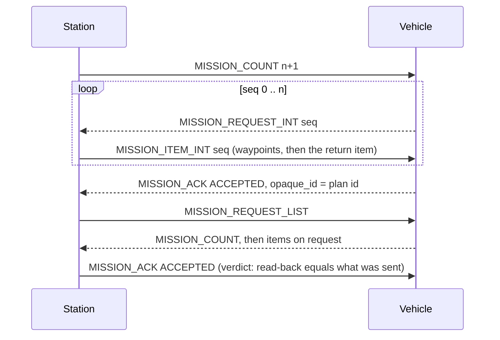

# Link contract: missions

Part of [MARV-GCS](../README.md) · [link-contract](link-contract.md), section 17

MAVLink's mission protocol cut down to a subset, with the messages of `common` unchanged (no dialect change, no new MARV
message). It binds the vehicle, the station (`gcs-mavlink`, the Map tab, `marv-cli`) and `gcs-sim`; each is built from this
text. Scope: upload, read back, clear and store a list of waypoints; a stored list is flown in AUTO ([link-flight](link-flight.md)).
Where MAVLink's own description (`MM`, <https://mavlink.io/en/services/mission.html>) leaves a point open, the rule here
settles it. Timers, pacing, the station's verdict and worked examples: [link-missions-examples](link-missions-examples.md).



## Messages

| Message | Id | CRC_EXTRA | Length | Station sends | Vehicle sends |
|---|---|---|---|---|---|
| `MISSION_REQUEST_LIST` | 43 | 132 | 3 | to start a download | never |
| `MISSION_COUNT` | 44 | 221 | 9 | to start an upload | to answer `MISSION_REQUEST_LIST` |
| `MISSION_CLEAR_ALL` | 45 | 232 | 3 | to clear | never |
| `MISSION_ACK` | 47 | 153 | 8 | to end a download; to give up | to end an upload or a clear; every refusal |
| `MISSION_REQUEST_INT` | 51 | 196 | 5 | in a download | in an upload |
| `MISSION_ITEM_INT` | 73 | 38 | 38 | in an upload | in a download |

The `common.xml` of `marv-dialect` has the extension field `mission_type` in all six messages and `opaque_id` (uint32) in
`MISSION_COUNT` and `MISSION_ACK`. MAVLink 2 cuts trailing zero bytes from a payload: a receiver reads every missing byte as
0. Not served: `MISSION_ITEM` (39) and `MISSION_REQUEST` (40) (deprecated; the vehicle drops them and the station never sends
them), `MISSION_WRITE_PARTIAL_LIST`, `MISSION_SET_CURRENT`, `MISSION_CURRENT`, `MISSION_ITEM_REACHED`, and the fence and
rally plan types.

## Where and addressing

On both of the vehicle's links, USB and radio, identically (same messages, values, rules, timers; only the reply pacing
differs). One service on the vehicle serves both. The station uses it on every session, serial, TCP and UDP
([link-access](link-access.md)).

- The station sends every mission message with `target_system` and `target_component` = the vehicle's, learned from its
  heartbeat (1 and 1).
- The vehicle handles a mission message only when `target_system` is 0 or 1 and `target_component` is 0 or 1; any other is
  dropped and not answered. It addresses every message it sends to the system and component that sent the message it
  answers (the station: 255 and 190), on the link it came from.
- The station takes a mission message only from the vehicle's system and component, with `target_system` and
  `target_component` 0 or its own; it drops any other.

## The list

The vehicle's list is n items: up to 16 waypoints, then exactly one **return item**, the last. `count` is 1 to 17; a `count`
of 1 is the return item alone (it sets the return height; Start is refused with it). A `count` of 0 is valid and clears the
list (as MAVLink's "uploading an empty mission"). A `count` of 18 or more is refused with `MAV_MISSION_NO_SPACE`. The station
refuses more than 16 waypoints, or a return height that is not finite, before anything is sent.

`seq` 0 is the first waypoint (ArduPilot's home position at `seq` 0 is not followed). Field values of `MISSION_ITEM_INT`:

| Field | Station sends (upload) | Vehicle accepts | Vehicle sends (download) | Station accepts |
|---|---|---|---|---|
| `seq` | the seq requested | the expected seq only | the seq requested | the expected seq only |
| `frame` | 3 (`MAV_FRAME_GLOBAL_RELATIVE_ALT`) | 3 or 6 (`MAV_FRAME_GLOBAL_RELATIVE_ALT_INT`, the same frame); else refused | 3 (the frame is not stored) | compared (read-back) |
| `command` | 16 (`MAV_CMD_NAV_WAYPOINT`); the return item 20 (`MAV_CMD_NAV_RETURN_TO_LAUNCH`) | 16 for items before the last, 20 for the last; see checks | 16, or 20 for the return item | compared |
| `current`, `autocontinue` | 0, 1 | ignored | 0, 1 | ignored |
| `param1` to `param4` | 0.0 | ignored (any value, NaN too) | 0.0 | ignored |
| `x` | latitude degrees x 10^7; the return item 0 | -900000000..900000000; the return item 0 | as stored | compared |
| `y` | longitude degrees x 10^7; the return item 0 | -1800000000..1800000000; the return item 0 | as stored | compared |
| `z` | altitude in m above home, finite; the return item: the return height | finite, within `GDN_ALT_MIN` to `GDN_ALT_MAX`; its 4 bytes stored unchanged | the stored 4 bytes | compared as 4 bytes |
| `mission_type` | 0 | 0; else refused | 0 | 0; else dropped |

The return item deviates from `common.xml`, where `MAV_CMD_NAV_RETURN_TO_LAUNCH` has every parameter empty: here its `z`
carries the return height in m above home, the mission input that may differ from mission to mission. The vehicle never
flies it as a leg: after the last waypoint AUTO goes to HOLD at its height, the place dropped; its `z` is used only by
RETURN, which flies home at the larger of it and the present height, latched at entry. With no list stored RETURN flies at
the present height.

Height: frames 3 and 6 both mean `z` in m above home (home's height is the steering estimate's height at the arming step, so
a list stored on the ground gives heights above the place of the next arming). The limits `GDN_ALT_MIN` and `GDN_ALT_MAX`
([link-parameters](link-parameters.md), defaults 5 m and 50 m) are checked at upload only, against the values in force then;
not again at commit, at Start or in flight.

## Storage, staging and commit

The list lives in the vehicle's RAM only: empty after every boot (plan id 0), never written to flash; a link going down does
not touch it. Per item the vehicle keeps `x`, `y` and the 4 bytes of `z` (12 bytes, 204 for 17 items); `frame` and
`command` are not stored (3 and 16, and 20 for the last item, on download), so a list uploaded with frame 6 reads back with
frame 3.

An upload writes into a staging copy. When the last item (`seq` n - 1) has passed every check, the staging copy replaces the
stored list in one step, the plan id is computed, and only then `MISSION_ACK` ACCEPTED is sent. Whatever reads the stored
list sees the old list or the new one, never a mix. Every other end of an upload (a refusal, a cancel, a timeout, the link
going down, a new start message from the initiator, a reboot) discards the staging copy: the stored list and its plan id stay
as they were.

## Plan id

| Item | Rule |
|---|---|
| Algorithm | IEEE CRC-32, as in the firmware's `crates/fw-core/src/record.rs` (`crc32`): reflected polynomial 0xEDB88320, initial 0xFFFFFFFF, final XOR 0xFFFFFFFF; the CRC of the ASCII bytes "123456789" is 0xCBF43926 |
| Bytes covered | 12 x n bytes for `seq` = 0 .. n - 1, the return item included: `x` as int32 little-endian, `y` as int32 little-endian, `z` as IEEE-754 single bits little-endian. Nothing else. The return item contributes 8 bytes of 0, then its `z` |
| Empty list | Covers no bytes: plan id 0x00000000. If the CRC of a non-empty list is 0 the plan id is 0x00000001 (0 means "no plan") |
| Where it travels | `MISSION_ACK` `opaque_id` when an upload is accepted; `MISSION_COUNT` `opaque_id` in every download. The station computes it from the waypoints it sent. Test vector: [example 3](link-missions-examples.md) |

## Transactions and the vehicle's rules

One transaction at a time for the whole vehicle, across both links. An upload and a download are transactions; a clear (and
an upload of count 0) is answered at once. The start messages are `MISSION_COUNT`, `MISSION_REQUEST_LIST` and
`MISSION_CLEAR_ALL`. The initiator of a transaction is (link, system id, component id) of the frame that started it; the same
station on the other link is another initiator. For each message that passed the addressing check:

1. While a transaction runs, a message from anyone but its initiator (`MISSION_COUNT`, `MISSION_REQUEST_LIST`,
   `MISSION_CLEAR_ALL`, `MISSION_ITEM_INT`, `MISSION_REQUEST_INT`) gets `MISSION_ACK` DENIED; a `MISSION_ACK` is ignored.
   The running transaction is not changed.
2. A start message from the initiator ends the initiator's running transaction (as a cancel: staging discarded, nothing sent) and is
   then handled as in 3.
3. No transaction running:
   - `MISSION_COUNT`, in this order: `mission_type` not 0: UNSUPPORTED; armed (see below): ERROR; `count` above 17:
     NO_SPACE. `count` 0: the list is emptied, ACK ACCEPTED (`opaque_id` 0). `count` 1 to 17: an upload starts with
     `MISSION_REQUEST_INT` `seq` 0.
   - `MISSION_CLEAR_ALL`: `mission_type` not 0 (255, `MAV_MISSION_TYPE_ALL`, included): UNSUPPORTED; armed: ERROR.
     Otherwise the list is emptied (also when empty) and ACK ACCEPTED (`opaque_id` 0).
   - `MISSION_REQUEST_LIST`: `mission_type` not 0: UNSUPPORTED. Otherwise a download starts with `MISSION_COUNT` (`count`,
     plan id). Allowed while armed.
   - `MISSION_ITEM_INT`: from the initiator of the last upload with the `seq` of the item that ended it, the ACK that ended it is
     sent again unchanged and nothing else happens (a lost final ACK). Any other: ACK ERROR.
   - `MISSION_REQUEST_INT`: ACK ERROR. `MISSION_ACK`: ignored.
   The vehicle remembers the last upload that ended at an item (accepted, or refused at an item): initiator, that item's `seq`
   and the ACK it sent; it forgets it on any start message from anyone, when that initiator's link goes down, and at reboot.
4. In the initiator's upload, expecting `seq` k, `MISSION_ITEM_INT` is checked in this order: `seq` not k (a repeat or out of
   order): dropped with no other check and `MISSION_REQUEST_INT` k sent again (not an error); `mission_type` not 0:
   UNSUPPORTED; armed: ERROR; `command`: at k = n - 1 not 20, or 20 at any other k: INVALID, and neither 16 nor 20:
   UNSUPPORTED; `frame` not 3 or 6: UNSUPPORTED_FRAME; `x` (a waypoint's out of range, or the return item's not 0):
   INVALID_PARAM5_X; `y`: INVALID_PARAM6_Y; `z` not finite or outside the limits: INVALID_PARAM7. A passing item is stored
   in staging; then `MISSION_REQUEST_INT` k + 1, or, when k = n - 1, the commit and ACK ACCEPTED with the new plan id.
   `MISSION_ACK`, any type: the upload ends as cancelled, staging discarded, no reply. `MISSION_REQUEST_INT`: dropped.
5. In the initiator's download of n items: `MISSION_REQUEST_INT` with `mission_type` not 0: UNSUPPORTED; `seq` n or above:
   INVALID_SEQUENCE; otherwise `MISSION_ITEM_INT` of that `seq`, as often as asked. `MISSION_ACK`, any type: the download
   ends, no reply. `MISSION_ITEM_INT`: dropped.
6. Every `MISSION_ACK` the vehicle sends with a type other than ACCEPTED ends the transaction it answers, if one runs, with
   the stored list unchanged; a DENIED to another sender ends nothing.

**Armed.** A vehicle that does not fly lists refuses `MISSION_COUNT`, `MISSION_CLEAR_ALL` and the items of an upload while
armed (ERROR); `gcs-sim` does. A vehicle that flies the list in AUTO takes them while armed: an upload in flight redirects
the vehicle. The flight core takes only a whole committed list (staging, the atomic commit, then the whole-set triple
buffer), at its next step; a partly received list never flies. A new plan id (an accepted upload or a clear): in AUTO, HOLD
with the place dropped; in HOLD, the place dropped, so Start begins at `seq` 0; in RETURN and LAND nothing changes (the
return height was latched at entry); in PILOT and TAKEOVER the shadow guidance starts over.

## Results (`MAV_MISSION_RESULT`)

| Case | `type` |
|---|---|
| An upload committed, a clear, an upload of count 0, the end of a download (from the station) | ACCEPTED (0) |
| Armed: `MISSION_COUNT`, `MISSION_CLEAR_ALL` or an item (where refused); an item (other than a lost final ACK's repeat) or a `MISSION_REQUEST_INT` with no transaction running | ERROR (1) |
| `frame` not 3 or 6 | UNSUPPORTED_FRAME (2) |
| `mission_type` not 0; a waypoint's `command` neither 16 nor 20 | UNSUPPORTED (3) |
| `count` above 17 | NO_SPACE (4) |
| The last item's `command` not 20, or 20 at another `seq` | INVALID (5): the station says "the list does not end in a return item" |
| A waypoint's latitude out of range, or the return item's `x` not 0 | INVALID_PARAM5_X (10) |
| A waypoint's longitude out of range, or the return item's `y` not 0 | INVALID_PARAM6_Y (11) |
| `z` not finite, or outside [`GDN_ALT_MIN`, `GDN_ALT_MAX`] | INVALID_PARAM7 (12): the station says "a height is outside the vehicle's limits (GDN_ALT_MIN to GDN_ALT_MAX)" |
| A `MISSION_REQUEST_INT` for a `seq` at or above the count (either side) | INVALID_SEQUENCE (13) |
| Another initiator's transaction is running | DENIED (14) |
| Timeout: the sender gave up after its retries (either side) | OPERATION_CANCELLED (15) |

## Waypoints and the station's file

The station's file (QGC WPL 110, `crates/marv-gcs/src/missions.rs`, repeated in `crates/marv-cli/src/waypoints.rs`) holds a home
placeholder in row 0, the waypoints in rows 1 to n - 1 and the return item in row n: frame 3, command 20, latitude and
longitude 0, altitude = the return height. Row i is sent as `seq` i - 1; row 0 is never sent. `x` and `y` are the row's
latitude and longitude times 10^7, computed in f64 and rounded to nearest, halves away from zero; `z` is the row's altitude
as f32. A list read back is written with row i = `seq` i - 1 and row 0 made by the file's own rule. A file without the
command-20 row is a list from before the return item: the window gives it the default altitude as return height; the command
line refuses it unless `--return-height <m>` supplies one. For three waypoints and a return height of 20 m the last row
(tab-separated like every row):

```
4	0	3	20	0	0	0	0	0.00000000	0.00000000	20	1
```

## Related

[link-missions-examples](link-missions-examples.md) · [link-flight](link-flight.md) · [ui-map](ui-map.md) ·
[marv-cli](marv-cli.md)
