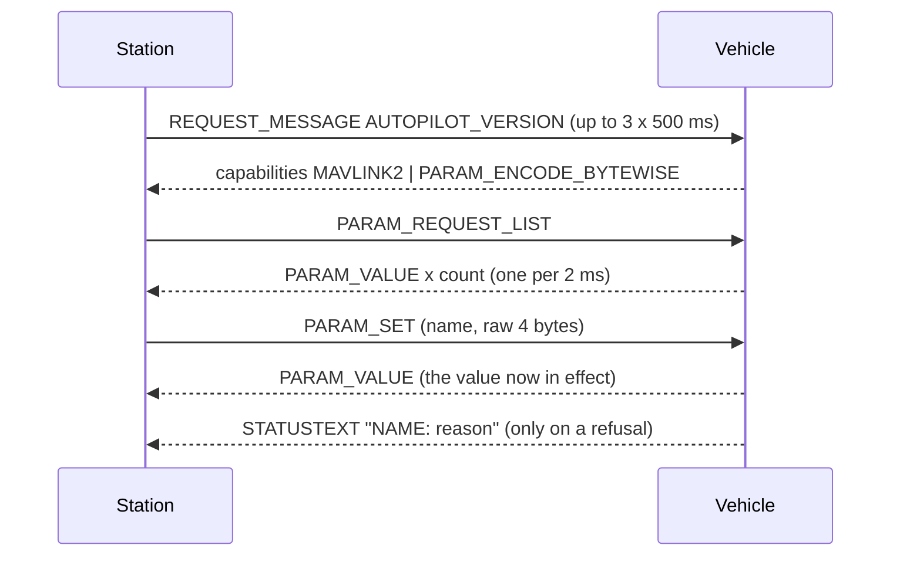

# Link contract: parameters

Part of [MARV-GCS](../README.md) · [link-contract](link-contract.md), section 2

How the parameter list is read and written, and the parameters this contract names. The set, its order and its count are
fixed for one boot; the Parameters tab lists whatever the vehicle reports, so a parameter not named here still appears
(without description or unit, which the station keeps in a table of its own, `gcs_mavlink::param_info`).

## Encoding and the vehicle's side

| Rule | Detail |
|---|---|
| Encoding | Byte-wise: the value's own little-endian bytes in the 4-byte value field. Only INT32 and REAL32 are used (a bool or an enum is an INT32) |
| Capabilities | The vehicle answers `MAV_CMD_REQUEST_MESSAGE` (512) for `AUTOPILOT_VERSION` (148) with `MAVLINK2` (8192) and `PARAM_ENCODE_BYTEWISE` (16) |
| Station | Asks for `AUTOPILOT_VERSION` on connect and uses the capability bit. With no reply after 3 x 500 ms, or neither bit set: C-cast when `HEARTBEAT.autopilot` is ARDUPILOTMEGA, otherwise byte-wise. It stores the raw 4 bytes and the type and decodes only to show or set, so the list never waits for the encoding; a write waits until the encoding is known |
| List | Paced at one `PARAM_VALUE` per 2 ms; read by index, or by name when the index is -1 |
| Set | Always answered with exactly one `PARAM_VALUE` carrying the value now in effect, also when refused. An unknown name or index gets no reply |
| Empty list | A vehicle with no parameters answers the list request with one `PARAM_VALUE` whose `param_count` is 0; the station shows an empty, complete list |
| Names | At most 16 characters of `[A-Z0-9_]`, unique, stable across versions. No `PARAM_ERROR` |
| Refusal text | On a refusal (read only, out of range, a setting the device cannot take) the vehicle also sends one `STATUSTEXT` "NAME: reason" right after the `PARAM_VALUE`. An accepted write sends none. A text belongs to the session, not to the command: the command line prints every text that arrives |

## Station timing

The specification gives none, so the station uses:

| Operation | Rule |
|---|---|
| List | No `PARAM_VALUE` within 1 s: resend the request, up to 3 times. 1 s of silence with entries missing: re-request the missing indices in rounds of 500 ms. Failed, with the number missing, after 8 consecutive rounds in which no missing index arrived. A change of `param_count` means fetch everything again |
| Read | 500 ms x 3 |
| Set | A `PARAM_VALUE` for the written name that arrives after the `PARAM_SET` went out ends the write at once: equal in raw bytes it confirms; any other value is the vehicle's refusal (the value in effect is shown, nothing is sent again). A stale `PARAM_VALUE` of the old value already in flight reads as a refusal too; the accepting echo that follows clears it, and the command line waits 300 ms for exactly this before reporting a refusal. Only when no `PARAM_VALUE` for that name arrives (a lost frame) does it send again: 3 sends 500 ms apart, then unanswered 500 ms after the third |
| During a list download | Its `PARAM_VALUE` frames are not answers: a differing value only notes the value in effect, an equal one still confirms, and the 3 sends / 500 ms rule decides (refused if some differing value was seen, otherwise unanswered) |

## Naming and groups

A parameter's name begins with its group (the device or function) followed by `_`; a name without `_` is in the group
"(other)". The Parameters tab shows a tree: `RC<n>` (n digits) and `RCMAP` under "RC controller", `ESC`, `MOT` and `DSHOT`
under "ESC", all others under "Flight controller". Nothing but the prefix decides; the link carries no other metadata.

## Parameters this contract names

Classes: **Live** applies at once; **Reboot** is configured at boot, a write changes RAM and the vehicle answers with the
INFO text `<NAME>: applies after reboot`. Every parameter goes to flash only on command 245 with param1 = 1.
Command 245 param1 = 3 resets sensor calibrations only (not the RC end points); param1 = 2 resets everything.

### RC block (device `MARV_DEVICE_RC` 7, all INT32, Live)

44 parameters, n = 1 to 8. Order: for n = 1 to 8 the five `RCn_*` as MIN, TRIM, MAX, REVERSED, DZ; then `RCMAP_ROLL`,
`RCMAP_PITCH`, `RCMAP_THROTTLE`, `RCMAP_YAW`. Meaning: [link-telemetry](link-telemetry.md). Reset by param1 = 2, not by 3.

| Name | Unit | Default | Range |
|---|---|---|---|
| `RCn_MIN` | us | 1100 | 800..2200 |
| `RCn_TRIM` | us | 1500 | 800..2200 |
| `RCn_MAX` | us | 1900 | 800..2200 |
| `RCn_REVERSED` | 0/1 | 0 | 0..1 |
| `RCn_DZ` | us | 0 | 0..200 |
| `RCMAP_ROLL` | channel | 1 | 1..8 |
| `RCMAP_PITCH` | channel | 2 | 1..8 |
| `RCMAP_THROTTLE` | channel | 3 | 1..8 |
| `RCMAP_YAW` | channel | 4 | 1..8 |

### Indexed parameters

| Index | Name | Type, unit | Default | Range | Class | Device | Meaning |
|---|---|---|---|---|---|---|---|
| 70 | `IMU1_ACC_FS` | I32, g | 16 | 2, 4, 8, 16, 32 | Reboot | IMU1 | accelerometer full scale |
| 71 | `IMU1_GYR_FS` | I32, dps | 2000 | 125..4000 | Reboot | IMU1 | gyro full scale |
| 72 | `IMU1_ODR_HZ` | I32, Hz | 800 | 25..800 | Reboot | IMU1 | output data rate |
| 73 | `IMU2_ACC_FS` | I32, g | 16 | 2, 4, 8, 16 | Reboot | IMU2 | |
| 74 | `IMU2_GYR_FS` | I32, dps | 2000 | 250..4000 | Reboot | IMU2 | |
| 75 | `IMU2_ODR_HZ` | I32, Hz | 800 | 25..800 | Reboot | IMU2 | |
| 76 | `AHRS_ORIENTATION` | I32 | 0 | 0..15 | Reboot | 0 (system) | the board's rotation in the vehicle (both IMUs) |
| 77 | `MAG_ORIENT` | I32 | 10 | 0..15 | Live | MAG | the external compass's rotation in the vehicle |
| 78 | `MOT_POLES` | I32 | 14 | 2..64 | Live | ESC (12) | magnets per motor, for rpm |
| 79 | `LED_BRIGHT` | I32 | 1 | 0..3 | Live | 0 (system) | status LED: 0 off, 1 dim, 2 medium, 3 bright |
| 80 | `GPS_RATE_MS` | I32, ms | 200 | 100, 200, 500, 1000 | Live | GNSS | fix interval |
| 81..91 | compass block | | | | Live | MAG | [link-compass](link-compass.md) |
| 92 | `GPS_GNSS` | I32 | 0 | 0..2 | Live | GNSS | constellation set; the receiver is re-configured on the write, no reboot |
| 119 | `GDN_SRC` | I32 | 0 | 0..1 | Live | 0 (system) | where the shadow guidance takes its targets: 0 the `GDN_*` parameters, 1 the committed mission ([link-missions](link-missions.md); the radius stays `GDN_RADIUS`) |

Notes:

- Orientation values are ArduPilot's rotation numbers 0..15: 0 none, 1..7 yaw 45..315, 8 roll 180, 9..11 roll 180 + yaw
  45..135, 12 pitch 180, 13..15 roll 180 + yaw 225..315.
- The BARO and MAG fields keep earlier indices, types and defaults: `BARO_ODR_HZ` 50, `BARO_OSR_P` 16, `BARO_OSR_T` 2,
  `BARO_IIR_P` 0, `BARO_IIR_T` 0, `MAG_ODR_HZ` 100 (REAL32), `MAG_AVG` 2: the Balanced values. The 13 fields a sensor
  preset sets are these seven plus the six IMU parameters; calibration offsets are not among them. The IMU defaults are the
  Flight preset's values. The vehicle has no preset selector: every write is checked against the parameter's own range (and,
  for BARO and MAG, the driver's rules).
- `GPS_GNSS`: 0 GPS + Galileo + BeiDou B1C + QZSS, 1 GPS + Galileo, 2 GPS + Galileo + GLONASS. The firmware refuses a
  `GPS_RATE_MS` faster than the constellation set allows: 100 ms only with `GPS_GNSS` 1, with a text that names both values.
- `GDN_ALT_MIN` and `GDN_ALT_MAX` (F32, m, Live, group `GDN`): the lowest and highest `z` above home of a mission waypoint
  or the return item, default 5.0 and 50.0. Their indices and ranges belong to the firmware and are not part of this
  contract; the station reads them like any parameter.
- Indices 93 to 118 (guidance and gain parameters) are not listed here.

## Related

[link-contract](link-contract.md) · [link-compass](link-compass.md) · [link-presets](link-presets.md) ·
[ui-tabs](ui-tabs.md) (Parameters tab)
