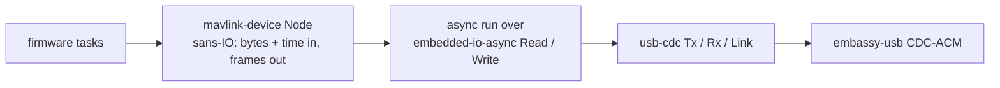

# Link contract: the USB crate and the device layer

Part of [MARV-GCS](../README.md) · [link-contract](link-contract.md), sections 3 and 4

The vehicle's end of the link is two crates in their own repositories: [usb-cdc](https://github.com/Lmx154/usb-cdc) (bytes
over USB, no MAVLink) and [mavlink-device](https://github.com/Lmx154/mavlink-device) (MAVLink on any byte stream, no USB).
This page records the behaviour the station relies on; the code and tests live in those repositories.



## 3. `usb-cdc`

A thin crate on embassy-usb 0.6 `CdcAcmClass`: a byte pipe through `embedded-io-async` 0.7 plus a link state. No queue, no
task, no MAVLink. It exists because the bare class has three traps on this HAL:

1. `Sender::write` can end a transfer on a full-size chunk and `flush` does nothing: the computer may hold the data back.
2. A zero-length chunk from the computer comes out of `BufferedReceiver::read` as `Ok(0)`, which `embedded-io-async` defines
   as end of file.
3. On embassy-rp 0.10.0 endpoint reads and writes never return `Disabled` and a bus reset does not fail pending futures: a
   write in flight when the cable is pulled hangs until the next enumeration.

Required behaviour:

| Rule | Detail |
|---|---|
| Up | Configured and not suspended, from the crate's own `Handler`; down on reset, deconfigure, suspend, disable |
| While down | `read` and `write` return `Err(NotConnected)` at once |
| Computer not reading | `write` waits; only the calling task waits; a dropped write has sent nothing |
| Chunk size | No IN chunk is longer than 63 bytes (max chunk size - 1), so no transfer ever needs a zero-length chunk |
| Zero-length chunks from the computer | Skipped and counted; `read` never returns `Ok(0)` for a non-empty buffer |
| Link down | A partly read chunk is thrown away. DTR is reported; the crate never gates data on it |
| Firmware | Builds the `embassy_usb::Builder` with its own identity and runs `UsbDevice::run()` in a task it never cancels; the crate adds the CDC function and one handler |

```rust
pub struct UsbCdc<'d, D: Driver<'d>>;
impl UsbCdc { pub fn new(builder: &mut Builder<'d, D>, state: &'d mut State<'d>, config: Config) -> Self;
              pub fn split(self) -> (Tx<'d, D>, Rx<'d, D>, Link<'d>); }       // Tx: Write, Rx: Read
impl Link<'_> { is_up(), dtr(), wait_up(), wait_down(), stats() }
#[non_exhaustive] pub enum Error { NotConnected }
```

Dependencies: embassy-usb 0.6 (no default features), `embedded-io-async` 0.7, optional defmt. It works with any HAL that
implements embassy-usb-driver and any executor; it does not work on the `usb-device` stack and has no blocking front end.
`Tx`, `Rx` and `Link` are not `Send` (embassy-usb's control state is not `Sync`): they may be used from different executors
on the same core, never across cores. The link state sits behind a critical-section mutex because the `Handler` callbacks
run in the `UsbDevice::run()` task. Identity: the bench values (0xc0de:0xcafe) are for the bench only; strings by default
manufacturer "MARV", product "MARV V2", serial number from the chip's unique id.

### The start gate

After every enumeration the computer's tty starts in cooked mode (canonical, echo, signal characters) and cdc_acm starts
reading inside `open()`, about 1 ms before the opening program can set raw mode. A board that is already writing has its
first bytes (about 117) edited, partly dropped and echoed back: the station saw 32 to 95 discarded bytes and sometimes one
checksum error in its first read, and the start-up text never arrived. Raw mode lands 0.31 to 0.35 ms after DTR; a station's
first heartbeat is sent after its `open()` returned. Nothing on the computer removes the window without a kernel change.

The rule, in the firmware's USB link task only (built from public pieces `Link::dtr()`, `Node::receive`,
`Node::gcs_present`; neither crate changes): after each link-up write nothing until DTR has held true for 100 ms (checked at
most 5 ms apart) or a station `HEARTBEAT` has arrived, whichever comes first; meanwhile read and pass bytes to
`Node::receive`. Then run the node as before, also into a closed port, until the link goes down. It never falls silent
because the station is gone. A later open within the same enumeration is already raw, so no new gate applies; such a session
may begin with the tail of one frame, and the station resynchronises. A station must resynchronise at the start of any
session regardless. Rejected: DTR alone (silent for a host that never raises it), a received frame alone (silent for a
program that only listens), a timeout fallback, a gate inside the crates.

## 4. `mavlink-device`

A sans-IO core (`Node`: bytes and time in, frames out) and one thin `async run` over any `embedded_io_async::{Read, Write}`.
No USB, transport or executor dependency.

| Topic | Rule |
|---|---|
| Codec | The message types come from `marv-dialect`, which runs `mavlink-bindgen` =0.21.0 as a build dependency (with `mav2-message-extensions`) over `common.xml`, `standard.xml` and `minimal.xml` copied byte-identical from the `mavlink` 0.21.0 package. The stock `mavlink` crate is not used on the target: with extension fields and no std it does not build, and without them `HIGHRES_IMU` has no `id` and several messages lose their extension fields |
| Serialisation | At the message-struct level only (`serialize_message_data`, `D::deser`, `calculate_crc` with `D::EXTRA_CRC`), with its own deframer; never the `MavMessage` enum's `ser` / `parse` or the `write_*` helpers (they cost about 70 kB of flash) |
| Lock-step check | In `marv-dialect` (`cargo test --test same_wire`, against the std `mavlink` crate as a dev dependency): the sha256 of each vendored file; for every message id the name, EXTRA_CRC, ENCODED_LEN and the bytes of a non-zero payload after a round trip (an all-zero payload proves nothing: MAVLink 2 strips trailing zeros); and a positive control that fails against a `mavlink` built without extension fields |
| The layer owns | Framing, sequence numbers, CRC; `HEARTBEAT` and presence of the station; the parameter protocol; commands 511 and 512 and UNSUPPORTED for the rest; the stream scheduler; a `STATUSTEXT` queue of 4 |
| The firmware passes in | Parameter storage, validation and persistence (`ParamStore`); sensor values, sampled when due and never queued (`Telemetry`); the stream table; time; the task; the byte stream |

```rust
pub trait ParamStore { fn count(&self) -> u16; fn name(&self, i: u16) -> Option<ParamName>; fn get(&self, i: u16) -> Option<ParamValue>;
    fn find(&self, n: &ParamName) -> Option<u16>; fn set(&mut self, i: u16, v: ParamValue) -> Result<ParamValue, ParamError>; }
pub trait Telemetry { fn sample(&mut self, message_id: u32, now_us: u64, out: &mut Outgoing<'_>) -> bool; }
impl<'a> Node<'a> {
    pub fn new(config: Config, streams: &'a mut [StreamSlot]) -> Self;
    pub fn receive(&mut self, bytes: &[u8], now_us: u64, params: &mut impl ParamStore);
    pub fn poll_transmit(&mut self, now_us: u64, params: &impl ParamStore, tel: &mut impl Telemetry, frame: &mut [u8; 280]) -> Option<usize>;
    pub fn next_deadline_us(&self) -> u64;
    pub fn on_link_down(&mut self);
    pub async fn run<R, W, D>(&mut self, rx: &mut R, tx: &mut W, delay: &mut D, now_us: impl FnMut() -> u64,
        params: &mut impl ParamStore, tel: &mut impl Telemetry) -> RunError<R::Error, W::Error>;
}
```

Dependencies: `marv-dialect`, `embedded-io-async` 0.7, `embedded-hal-async` 1.0, optional defmt; the std `mavlink` crate only
as a dev dependency. For the target, `cargo tree -e normal | grep -cE 'mavlink-bindgen|quick-xml|regex|mavlink v'` is 0 and
`cargo tree -e normal | grep -cE 'usb|serialport|embassy'` is 0.

## Related

[link-contract](link-contract.md) · [link-parameters](link-parameters.md) · [architecture](architecture.md)
