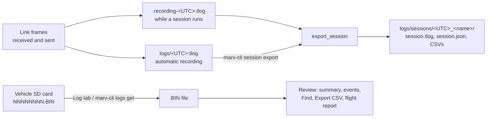

# Recordings, sessions and logs

Part of [MARV-GCS](../README.md)

Three kinds of record, all read through the Log tab or `marv-cli`: the station's own `.tlog` recording of a link, a
session folder (a recording turned into CSV and JSON that a script can read), and the DataFlash `.BIN` logs the vehicle
writes to its SD card.



## Station recording (`.tlog`)

Every session on a link is recorded automatically to `logs/<UTC time>.tlog` (`--log-dir` changes the folder, `--no-log`
turns it off). The record layout is the one Mission Planner, QGroundControl and pymavlink read: 8 bytes big-endian of Unix
microseconds, then the frame. A log can be replayed through the same tabs (`--connect tlog:PATH` at the recorded pace,
`tlogfast:PATH` as fast as read, or a session's Replay button). A real-time replay waits out the gaps of the recording.
The `.tlog` holds the frames the station sent as well as those it received, so a command's acknowledgement can be named.
`marv-cli record FILE` writes one without a window.

## Session folders

A session is a folder an agent or a person reads with Python's `csv` and `json`, `awk` and `grep`: no MAVLink library.
`marv-cli session export FILE.tlog` makes one from any recording; the converter is
`gcs_link::session_folder::export_session`.

```
logs/sessions/YYYY-MM-DD_hh-mm-ssZ_calibration_1/   <UTC time of the first frame>_<name, file-safe>
  session.tlog          the frames (the export of a whole recording is a copy): the Log tab replays it
  session.json          what this session was: read it first
  HIGHRES_IMU.csv       one file per message type in the recording
  SCALED_PRESSURE.csv   ...
```

A folder that exists is never overwritten. The vehicle's frames go to the CSVs and summaries; the station's own (system
255: commands, heartbeats, parameter requests) stay in `session.tlog` and are counted in `station_frames`.

**CSV.** A header row, then one row per message. The first column is `t_s`, seconds since the session start (the receive
time of the first frame; 6 decimals); the second is the message's own time (`time_usec` or `time_boot_ms`) when it has
one; then the other fields in the wire order of the `mavlink` crate's structs (large fields first). An array field is flat
(`name_0`, `name_1`, ...). An enum is its name; a bit-flag field (`HIGHRES_IMU.fields_updated`, the `SYS_STATUS` masks,
`HEARTBEAT.base_mode`) is its integer value and has no mean in the summary; an infinite or not-a-number value is `nan`; a
text with a comma is double-quoted. Instances of one message (`HIGHRES_IMU` `id`, `MARV_DEVICE_STATUS` `device_id`) share
a file, told apart by that column.

**Privacy.** No latitude or longitude is in any CSV or in `session.json`; only `session.tlog` holds them. Every field named
`lat`, `lon`, `latitude`, `longitude`, `*_lat`, `*_lon`, `lat_*` or `lon_*` is dropped (`GPS_RAW_INT.csv` has no `lat` or
`lon`; `GLOBAL_POSITION_INT.csv` keeps `alt`, `relative_alt`, `vx`, `vy`, `vz`, `hdg`); messages that are only positions
(`GPS_GLOBAL_ORIGIN`, `SET_GPS_GLOBAL_ORIGIN`, `HOME_POSITION`, `SET_HOME_POSITION`, `MISSION_ITEM`, `MISSION_ITEM_INT`,
`COMMAND_INT`) are not written and are listed in `skipped`.

**`session.json`** (`schema_version` 1; `t_s` is always seconds since the start):

| Key | Type | Meaning |
|---|---|---|
| `schema_version` | number | 1 |
| `name` | string | the name as given |
| `start_utc`, `stop_utc` | string | `YYYY-MM-DDThh:mm:ss.mmmZ`: the first and last frame |
| `duration_s` | number | `stop - start` |
| `source` | string | the input file's name, no directory |
| `vehicle` | object | `system_id` (sender of the first autopilot heartbeat, else of the first frame; null if none) and `firmware` (from `AUTOPILOT_VERSION`: `major.minor.patch`, `-dev`/`-alpha`/`-beta`/`-rc`, the 8 custom bytes in hex in brackets when not all zero; null if none) |
| `station_frames` | number | frames the station sent (in `session.tlog` only) |
| `parameters.at_start` | object | name -> value: the snapshot when one was given, else the first `PARAM_VALUE` of each name |
| `parameters.changes` | list | `{t_s, name, old, new}` for each later `PARAM_VALUE` that differs from the one before |
| `marks` | list | `{t_s, kind, text}` by time; `kind` is `user`, `command` (every `COMMAND_ACK`: `MAV_CMD_PREFLIGHT_CALIBRATION (gyro): ACCEPTED`), `text` (every `STATUSTEXT`: `INFO: ...`) or `link` (`link lost` at the last frame before a silence over 3 s, `link back` at the first after it) |
| `files` | object | CSV file name -> rows |
| `skipped` | list | `{message, why}`: frames not written (positions only, not in the dialect, refused by the decoder) with their count |
| `units` | object | `{MESSAGE: {column: unit}}` for columns that have one |
| `summary.messages` | object | by message (`NAME`, or `NAME[instance]` for `HIGHRES_IMU` and `MARV_DEVICE_STATUS`): `count`, `rate_hz` (null with one message) and `fields`: per numeric column except the time, `{mean, sd, min, max}` (6 significant digits; `sd` is the sample standard deviation) |
| `summary.intervals` | list | empty without user marks; else one entry per interval between consecutive user marks, the start and the stop: `{from, to, start_s, end_s, messages}`; "before" and "after" a mark are two entries to compare |
| `warnings` | list | text: the recording ends inside a record (the frames before it are converted) |

**What a command's mark says.** A `MAV_CMD_PREFLIGHT_CALIBRATION` acknowledgement names the calibration of the station's
latest `COMMAND_LONG` for that command: `gyro`, `compass`, `accelerometer`, `ground pressure`, `radio`, `cancel`. Without
the station's frame it reads `MAV_CMD_PREFLIGHT_CALIBRATION: ACCEPTED`; an acknowledgement of a command the dialect does
not know reads `command N: RESULT`.

**Units.** The `mavlink` crate does not expose the definitions' units at run time, so `units` comes from a table in
`crates/gcs-link/src/session_folder.rs` for `HIGHRES_IMU`, `SCALED_IMU2`, `SCALED_PRESSURE`, `SYS_STATUS`, `GPS_RAW_INT`,
`RC_CHANNELS` (`chanN_raw`: us), `MANUAL_CONTROL` and `MARV_DEVICE_STATUS`. A message not in the table has no `units`
entry; add its fields to the table.

## Sessions from the window

On the Sensors tab the bar starts a named session (an empty name is the time of its first frame), drops marks with an
optional note, and stops. While it runs every frame, received and sent, is also written to
`<log dir>/sessions/.recording-<UTC time>.tlog`, beside the automatic recording. At Stop the window calls `export_session`
with the name, the parameter table as it was at the start (when the whole list had been read; otherwise the first
`PARAM_VALUE` of each name) and the marks, each stamped with the Unix time of the click. The export runs on a thread of its
own ("Saving…"). On success the bar says `Saved: <folder>` and the `.recording-` file is deleted; on failure it gives the
error and the path of the kept `.recording-` file (convert it later with `marv-cli session export`). A session also ends
on Disconnect, when another connection or a replay replaces the link, and when the window closes (closing waits for the
export). A session that recorded no frame is not written. `--no-log` turns sessions off. The cut of a longer recording to a
time range is not built.

## Log tab

| Section | What it does |
|---|---|
| Station recording (`.tlog`) | The automatic recordings. Under it "Sessions": the folders of `logs/sessions/`, newest first (folder, name, start, duration, marks), read when the tab opens and after a session was saved, each with Replay |
| On-board logs (SD card) | The SD row (state, last error, blocks written, age) or "no SD row yet"; Restart SD; Refresh list and a table of the card's logs (number, bytes, MiB, the last one marked "being written"); per row Download. All Configure-only |
| Review a log file | A local file; works with or without a vehicle, sends nothing, needs no Configure access |

**Download.** To `<folder>/NNNNNNNN.BIN` (the folder is a text field, default the window's log directory; an existing file is
never overwritten, the reason is shown). One download at a time with a progress bar (bytes, kB/s), Cancel, the line "Keep
the USB cable connected until the download finishes.", and the result or error in words. The file is written as
`NNNNNNNN.BIN.part` and renamed to `.BIN` only when every byte arrived; a download that fails (the link closed:
"Download of log N failed: link lost at X of Y bytes; reconnect and download again"; or no data for 6 s) or is cancelled
deletes the `.part` file, so a half file never looks like a log and the download can be repeated at once. Wire rules and
pacing: [link-logs](link-logs.md); the CLI form: [marv-cli](marv-cli.md#log-download).

**Review.** A path field with Open and Browse… (the desktop's file dialog, starting in the log directory, showing `.BIN`
files of any letter case, "All files" as the other choice; without a desktop file-chooser portal and a D-Bus session a red
one-line reason is shown and the path is typed), a drop-down of the `.BIN` files in the log directory (newest first), a
Review button next to a finished download, or `--review`. A background pass with a progress bar and Cancel reads the file
twice (summary, then events); the window never waits for it. It shows:

| Part | Content |
|---|---|
| Summary | Name, size, duration, wall-clock start when the log has a GPS time, records per type, bad and tail bytes |
| Events | Time since boot, wall clock, source, text, a checkbox per source, the first record of a source marked "initial" |
| Find | A condition such as `BAT.Volt < 14.8`: a mistake is shown with its position and reason before any pass; then the intervals where it held with the smallest and largest value of each named field, and "N more not kept" past 10 000 |
| Export CSV | A checkbox per record type, an optional rate in Hz, an optional condition, a folder that starts as the file's own; per type the rows written and skipped and the file, or the error; an existing file is never overwritten and is named |
| Text messages | The vehicle's text messages in a box of their own; the tab scrolls |

No coordinates are shown. The analysis behind Events, Find and Export: [dflog](dflog.md).

## Code

`crates/gcs-mavlink/src/tlog.rs` (record, read, replay), `crates/gcs-link/src/session_folder.rs` (converter),
`crates/marv-gcs/src/sessions.rs` and `views/log.rs`, `views/log_review.rs`, `crates/gcs-mavlink/src/services/logs.rs`.

## Related

[dflog](dflog.md) · [flight-report](flight-report.md) · [link-logs](link-logs.md) · [marv-cli](marv-cli.md) ·
[ui-tabs](ui-tabs.md)
