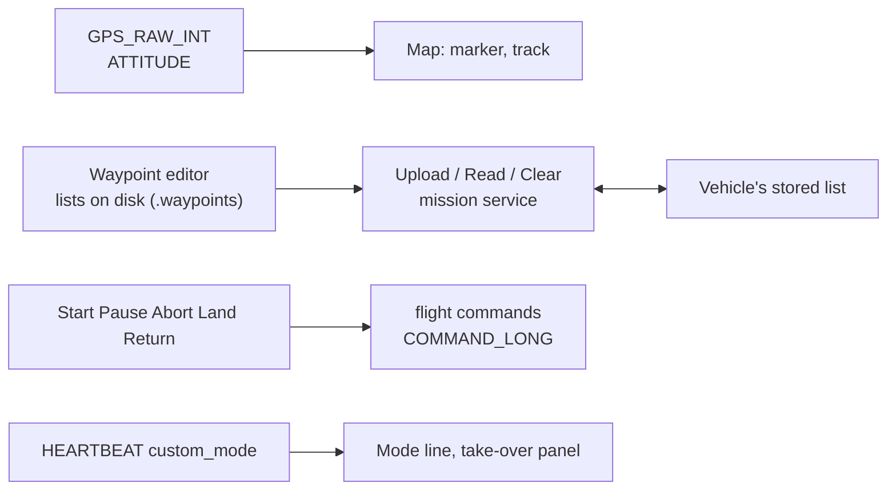

# Map tab: position, waypoints, missions, flight commands

Part of [MARV-GCS](../README.md)

The Map tab shows the vehicle on a dark street map or on aerial imagery, edits named waypoint lists, uploads them to the vehicle, and carries
the five flight buttons. The editor works with or without a vehicle and over every link, and writes no position of the
vehicle to any file or log.

## Position and track

| Item | Rule |
|---|---|
| Marker | The latest `GPS_RAW_INT` when its `fix_type` is 2D or better and it is younger than 3 s. The arrow turns by the `yaw` of `ATTITUDE` (0 = north, clockwise) while that is younger than 2 s, else points along the course over ground (`cog`), else a dot (`cog` 65535). The firmware sends no `ATTITUDE` yet, so on the real board the arrow follows `cog` |
| No fix | No marker before the first fix (world view, "waiting for a GPS fix"); afterwards the last known position stays grey with "no position" or "no GPS fix" |
| Home | While the vehicle sends `HOME_POSITION` ([link-contract](link-contract.md)): the badge "HOME SET" beside the mode line (shown only while the link is up and home is held), and a green marker with an "H" at the reported position. Both go when a `HEARTBEAT` reports STOP or mode 0, and when a new session starts; they stay while the heartbeat is lost (the badge is hidden, the marker stays). Nothing is shown before the first `HOME_POSITION` |
| Track | Every position of the session (at most 10 000, the oldest dropped) as a line; kept while another tab is open, cleared when a new session starts |
| Controls | "Follow vehicle" (on at the start; dragging turns it off), "Centre on vehicle", + and -, mouse wheel to zoom, drag to pan; the coordinates are written beside them. A compass rose sits bottom right; the map is always north up |

## Waypoint lists

A "Waypoints" button opens a panel at the right of the map. A left click on the map adds a waypoint to the end of the
current list (when "Add on click" is on, with the panel's default altitude); a right click within 10 pixels of one removes
it. Points are drawn as numbered amber circles joined in order.

| Panel part | Behaviour |
|---|---|
| List selector | New, Rename, Duplicate, Delete (Delete and Clear ask first) |
| Table | Latitude, longitude, altitude above home, move up, move down, remove; "Add by coordinates" (a pasted `lat, lon` in the latitude box fills both); count and length of the path; "Centre on waypoints" |
| Return height (m) | The height flown home, metres above home; saved with the list |
| Saving | Every change is saved at once, one file per list, in QGC WPL 110 text (`<name>.waypoints`, altitude relative to home) in `~/.local/share/marv-gcs/missions` (or `$XDG_DATA_HOME/marv-gcs/missions`). Lists stay when a new session starts |

The file has a home placeholder in row 0, the waypoints in rows 1 to n, and a last row of command 20 whose altitude is the
return height. A file without that row is a list from before the return item; the window gives it the default altitude as
return height. Format and field rules: [link-missions](link-missions.md).

## Pins from the vehicle

When the vehicle sends the text `MARK <n> <lat_e7> <lon_e7> <hacc_cm>` ([link-telemetry](link-telemetry.md), section 18) on any
link, the station adds a waypoint at that position to the end of the current list, with the panel's default altitude, as a
click on the map does, and saves the list. The map shows for 12 s "Pin 3 dropped from the vehicle, ±1.2 m"; for `MARK <n>
NOFIX` it shows "Mark 3: no GPS fix, nothing dropped" and adds nothing. Each `n` drops once; an `n` of 1 after higher ones
(a vehicle that started again) counts anew. The pin is added whether or not the panel is open and whichever tab is shown.

## On the vehicle

Under "On the vehicle": **Upload to vehicle**, **Read from vehicle**, **Clear on vehicle** ([link-missions](link-missions.md)).

| Behaviour | Detail |
|---|---|
| Role | Operate-class: enabled on Operate and Configure alike, so also over the UDP backpack link |
| Confirmation | Upload and Clear first ask "Upload N waypoints to the vehicle?" or "Clear the vehicle's waypoint list?" with Confirm and Cancel; a change of the list or selection cancels the question (`CONFIRM_BEFORE_SENDING` in `views/map/mission.rs` turns this off) |
| Checks before sending | At most 16 waypoints, every latitude and longitude finite and in range, finite altitudes and return height; a failure names the row and sends nothing |
| Verdict | An upload or clear counts only after the read-back matches what was sent. Progress reads "Uploading 2 of 3 waypoints"; success "Upload verified: the vehicle holds 3 waypoints, return height 20 m, plan id 0x1862F4A2"; failures give the vehicle's refusal in words, "no answer from the vehicle" or "link lost" |
| Display | The vehicle's list is drawn as blue dashed rings beside the edited list's amber discs. "Copy to a new list" is the only way the vehicle's list reaches a file |

## Flight commands

Five buttons: **Start**, **Pause**, **Abort**, **Land**, **Return**, with a mode line "Mode: <effective mode>" from the
heartbeat's `custom_mode` ("Mode: unknown (no vehicle)" when not connected). They are Operate-class and work over the
radio link; none arms, disarms or stops the motors. Wire rules, deny codes and the mode table: [link-flight](link-flight.md).

| Part | Behaviour |
|---|---|
| Gate | Disabled when not connected, or "a command is waiting for the vehicle" |
| Start | Asks "Start the stored mission?" first (Confirm / Cancel) |
| Result line | For the last flight command only: "<button>: sent, waiting for the vehicle"; "<button> ACCEPTED by the vehicle at HH:MM:SS"; "<button> REFUSED at HH:MM:SS: <reason text>"; "<button>: NO ANSWER from the vehicle (sent HH:MM:SS)" (laptop local time). Cleared when the next flight command is sent, otherwise kept until Dismiss |
| Take-over panel | Standing while the heartbeat reports TAKEOVER, HOLD, AUTO, RETURN, LAND or BLIND; full-width and red when the heartbeat stops while the last reported mode was one of those. It claims no switch position |

Panel wording, verbatim:

> MISSION SWITCH ON: the laptop flies. TO TAKE CONTROL: mode switch POSITION, ARM ON, throttle in the middle (advice), then MISSION SWITCH OFF: you fly in Position at once. Not in Position: control stays locked until it is. TO LAND NOW: ARM OFF with the mission switch ON. TO STOP THE MOTORS: ARM OFF and the mission switch OFF (they stop at once, in the air too). Do NOT change the transmitter model in the air: the vehicle ignores it for the rest of the flight.

In TAKEOVER it adds "Control locked: mode switch to POSITION, ARM ON". It always shows the link-loss line "If the link is
lost: the vehicle holds and, after 10 s without the link, returns to take-off (if home was set) / lands where it is (if no
home)" and "When the link returns with the mission switch ON the vehicle carries on."

## Tiles and privacy

The map has two types, chosen by the "Streets" and "Imagery" buttons on the top row. **Streets** is drawn by the station from
OpenFreeMap vector tiles (<https://openfreemap.org>: no key, no account, no request limit; OpenMapTiles schema,
OpenStreetMap data) in a dark style. **Imagery** is aerial photography from the USGS National Map (public domain), which
covers the United States.

| Fact | Detail |
|---|---|
| What leaves the computer | Tiles are fetched over HTTPS from `https://tiles.openfreemap.org` (Streets) and `https://basemap.nationalmap.gov` (Imagery) only for the part of the map on screen, or for the area of a download, with the User-Agent `MARV-GCS/<version> (MARV V2 ground station)`. The tile server learns which area you view and your computer's address. The vehicle's position is never sent, only tile numbers |
| Cache | One file per tile in `~/.cache/marv-gcs/tiles/streets` and `.../tiles/imagery` (or under `$XDG_CACHE_HOME/marv-gcs/tiles`). A file is used whatever its age and never replaced; only a tile with no file is fetched. Deleting a folder starts that map type over |
| Offline | The "Offline" box makes the map use only the tiles on disk and fetch none (no waiting on a network that is not there); a tile with no file stays blank. Without the box a missing tile is fetched when the network answers. Position and track are drawn either way |
| Download this area | See below |
| Credit | Streets: "OpenFreeMap © OpenMapTiles © OpenStreetMap contributors"; Imagery: "Imagery: USGS The National Map". The credit of the type shown is always drawn on the map |
| Zoom | The map zooms from 0 to 26. Streets tiles hold data up to zoom 14 and imagery tiles up to zoom 16 (zoom 17 does not exist on the server); closer, the last tile is drawn larger, so the map stays smooth but shows no more detail. A scale bar (round length in metres, centimetres below one) is drawn bottom left: at zoom 26 one metre is about 480 pixels wide, at zoom 22 about 30 |
| Dependencies | The `walkers` crate (MIT) with its `mvt` feature, which brings an HTTP client (`reqwest`, `tokio`, `rustls`) and `egui-wgpu`/`wgpu`, compiled but unused because the window uses glow and the station paints the tiles with egui; `marv-gcs` also names `reqwest` (blocking client, same version and TLS as walkers) for the tile fetching. Only `marv-gcs` depends on them |

### Download this area

"Download this area" opens a line under the top row. It takes the part of the map on screen and, for the map type shown (or
both, with "Both map types"), every tile from the zoom on screen down to the last zoom of the type (imagery 16, streets 14;
when the map is zoomed closer than that, only the last zoom), and stores them in the cache.

| Part | Behaviour |
|---|---|
| Estimate | Before anything is fetched: "1,234 tiles, zoom 13 to 16, about 31 MB at most" (the size from an average tile of 26 kB imagery or 45 kB streets) |
| Cap | More than 20,000 tiles are refused with "N tiles is more than the 20,000 allowed: zoom in to a smaller area"; the button stays off |
| Start | "Start download" is off while Offline is on ("Turn Offline off to download."). Six tiles are fetched at a time, the zoomed-out ones first. A tile already on disk is skipped |
| Progress | "Downloading: 1,200 of 5,000 tiles (29 MB, 1,100 fetched, 3 not available, 0 failed)" with a Cancel button; the end reads "Downloaded ...", "Cancelled after ..." or, after 25 tiles in a row that failed, "Stopped, the tile server does not answer ..." |
| Not available | A tile the server does not have (HTTP 404) is remembered as empty and not asked again |

Download at the field's coordinates before going out, on a connection with internet; the laptop-to-backpack link has none.

## Code

`crates/marv-gcs/src/views/map.rs` (map, track, editor), `views/map/mission.rs` (upload, read, clear, confirmations),
`views/map/flight.rs` (buttons, result line, panel), `views/map/marks.rs` (pins from the vehicle), `views/map/tilestore.rs`
(tiles on disk, imagery source), `views/map/offline.rs` (area download), `views/map/scale.rs` (scale bar),
`crates/marv-gcs/src/missions.rs` (lists on disk); services
`crates/gcs-mavlink/src/services/missions.rs` and `crates/gcs-mavlink/src/flight.rs`.

## Related

[link-missions](link-missions.md) · [link-flight](link-flight.md) · [marv-cli](marv-cli.md) (`mission` commands) ·
[ui](ui.md)
