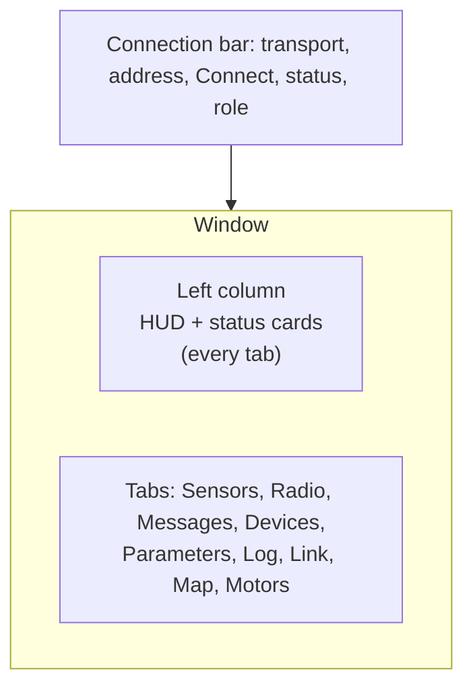

# The window (`marv-gcs`)

Part of [MARV-GCS](../README.md)

One window with a connection bar on top, a fixed left column (the HUD and status cards) and a row of tabs. The window
draws what the vehicle sends and sends only what a button asks for. The role of the link (Operate or Configure) decides
which controls are enabled; disabled controls show their reason and are never hidden.



## Starting it

```
marv-gcs [--connect <endpoint>] [--log-dir <dir>] [--no-log] [--view <name>]
         [--review <file.BIN>] [--screenshot <file.png>] [--after <seconds>]
```

| Option | Meaning |
|---|---|
| `--connect` | `tcp:HOST:PORT`, `serial:PATH[:BAUD]`, `udp:ADDR:PORT` (the local address to listen on), or a recording to replay: `tlog:PATH` (recorded pace) or `tlogfast:PATH` |
| `--log-dir` | Where automatic `.tlog` recordings and session folders go (default `logs`) |
| `--no-log` | No automatic recording and no sessions |
| `--view` | Tab shown at start, by title, any case |
| `--review` | Open a DataFlash `.BIN` in the Log tab's review section and start there (an explicit `--view` wins) |
| `--screenshot`, `--after` | Save a picture of the window after `--after` seconds (default 3) and exit |

## Connecting

| Link | How | Role |
|---|---|---|
| Serial | Choose `Serial`, pick the port (listed with product name and USB ids), Connect. The baud rate does not matter for a USB port. Needs the `dialout` group on Linux | Configure |
| TCP | `tcp:127.0.0.1:5760`, the simulator | Configure |
| UDP | Join the radio backpack's WiFi network (radio typically at `10.0.0.1`), choose `UDP`, local address `0.0.0.0:14550`. The radio sends MAVLink to port 14550; the station answers to whoever sent last | Operate |
| Replay | `tlog:PATH` or a session's Replay button | Operate |

A USB transmitter module is expected to use `serial:PATH:460800`. The status at the top right says `Connecting`,
`Connected` (with the vehicle's ids), `Lost` (no heartbeat for 5 s) or `Closed` (with the reason), then the role. Roles
and what each allows: [link-access](link-access.md).

## HUD and status cards

Top left, on every tab, 320 px wide at first (drag between 240 and 480). It is drawn from the messages the vehicle sends;
the station computes nothing from them except unit conversions.

| Part | Source and rule |
|---|---|
| Artificial horizon | `ATTITUDE`: roll (right wing down positive) and pitch (nose up positive), pitch ladder every 5 degrees, roll arc to 60 degrees. No `ATTITUDE`, or the last older than 2 s: level, grey, "no attitude from the vehicle" |
| Heading strip | `yaw` 0 to 359 with N/E/S/W; a small mark for the GPS course over ground |
| Speed and altitude boxes | `GPS_RAW_INT` `vel` (cm/s shown in m/s; 65535 unknown) and `alt` (mm shown in m, "GPS alt MSL"); values unknown or older than 3 s show `--` |
| Cards under it | Link status (state, heartbeat age, loss, `RADIO_STATUS` rssi, RC link), GPS, Battery (`SYS_STATUS`), Vehicle (armed from `HEARTBEAT`; motors "4/4 ESCs online" or the offline ones), Sensor status (one green line when every device row and enabled `SYS_STATUS` sensor is healthy, else only the ones that are not), Recent messages (last 3 `STATUSTEXT`, warnings and errors coloured) |

The HUD sends no command. Not connected: the drawing is grey.

## Tabs

| Tab | What it shows | Page |
|---|---|---|
| Sensors | Live plots from preset rows, the session bar | [ui-tabs](ui-tabs.md) |
| Radio | 16 channel bars, function bars, radio calibration, channel mapping | [ui-radio-devices](ui-radio-devices.md) |
| Messages | Every message with rate, count, age and all fields; any numeric field can be plotted | [ui-tabs](ui-tabs.md) |
| Devices | Device health table, calibrations, compass panel, sensor presets | [ui-radio-devices](ui-radio-devices.md) |
| Parameters | The vehicle's parameter tree, edit, save and load files, storage buttons | [ui-tabs](ui-tabs.md) |
| Log | Station recording and sessions, on-board SD logs, log review | [sessions-and-logs](sessions-and-logs.md) |
| Link | Connection counters, role, last refused command, Reboot vehicle | [ui-tabs](ui-tabs.md) |
| Map | Position, track, waypoint lists, mission upload, flight commands | [ui-map](ui-map.md) |
| Motors | ESC telemetry and the propellers-off motor test | [ui-tabs](ui-tabs.md) |

## What the vehicle sends

The tabs and the simulator's default streams show what the real firmware sends on its USB port:

| Message | Rate |
|---|---|
| `HEARTBEAT`, `SYS_STATUS`, `GPS_RAW_INT` | 1 Hz |
| `MARV_DEVICE_STATUS` | every row at least once a second |
| `HIGHRES_IMU` (id 0, IMU1 and the magnetometer), `SCALED_IMU2`, `SCALED_PRESSURE` | 25 Hz each |
| `RC_CHANNELS` | 5 Hz while the receiver delivers sticks |
| `MANUAL_CONTROL` | 5 Hz while a stick report is younger than 1 s |
| `ESC_STATUS` 10 Hz, `ESC_INFO` 1 Hz | USB only |
| `STATUSTEXT` | as they occur |

The simulator adds `ATTITUDE` at 10 Hz (the firmware sends none yet). The full table with limits is in
[link-contract](link-contract.md).

## Commands

Every button that changes something is a MAVLink command to the flight controller ([link-commands](link-commands.md)).
The `commands` service sends one `COMMAND_LONG` at a time (3 sends 1.5 s apart), follows `COMMAND_ACK` (IN_PROGRESS with
a percentage, then the final result) and gives up after 20 s of silence. While a command runs every command button is
disabled ("a command is running"), except Cancel calibration. The last command, in words ("Gyro calibration: 40 %",
"Reboot: no answer after 3 sends"), is shown under the buttons of the Parameters, Devices and Link tabs.

## Link test tool

`marv-link-test` has no window; it checks a radio link with the project's `MARV_TEST` message:

```
cargo run --release --bin marv-link-test -- --connect udp:0.0.0.0:14550 [--count 100] [--rate 10] [--duration 30] [--quiet-start 2]
```

It sends the station heartbeat (system 255, component 190) every second and, after the quiet start, `MARV_TEST` (tag 2,
`seq` counting up, `value` = `seq` x 3). Once a second and at the end it prints frames per sender and message, the
vehicle's `MARV_TEST` (tag 1) by `seq` (received, first, last, lost, duplicates, restarts), lost frames by header
sequence per sender with a percentage, bytes per second, checksum failures and `RADIO_STATUS` if it arrives. It makes no
pass or fail claim. Over UDP the first frames are discarded until the peer has sent something. A frame of an id the
dialect lacks is released only when the next frame starts.

## AppImage

`tools/appimage.sh` builds `target/appimage/MARV-GCS-x86_64.AppImage`, the window as one file (about 8 MB) that starts
with a double click and no flags. It is the AppImage type-2 runtime followed by a squashfs of `usr/bin/marv-gcs`,
`packaging/marv-gcs.desktop`, the icon and an `AppRun` that starts the window in a `MARV-GCS` folder of the user's
Documents folder, so recordings and downloads go to `logs` there from wherever it is started. Nothing else is bundled:
libc, libudev, libcap and the display libraries come from the host. It needs x86_64 Linux with glibc 2.39 or newer and
FUSE (`fuse3`); it is not built for the Pi.

## Code

`crates/marv-gcs/src/app.rs` (window, tab row, session and screenshot plumbing), `connection.rs`, `cli.rs`, `status.rs`,
`theme.rs`, `views/` (one file per tab; `views/mod.rs` is the registry). Folder map:
[marv-gcs](../crates/marv-gcs/README.md).

## Related

[architecture](architecture.md) · [extending](extending.md) · [link-access](link-access.md) · [marv-cli](marv-cli.md)
